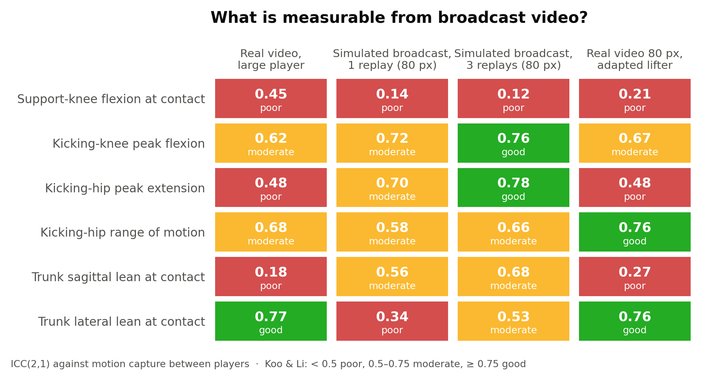
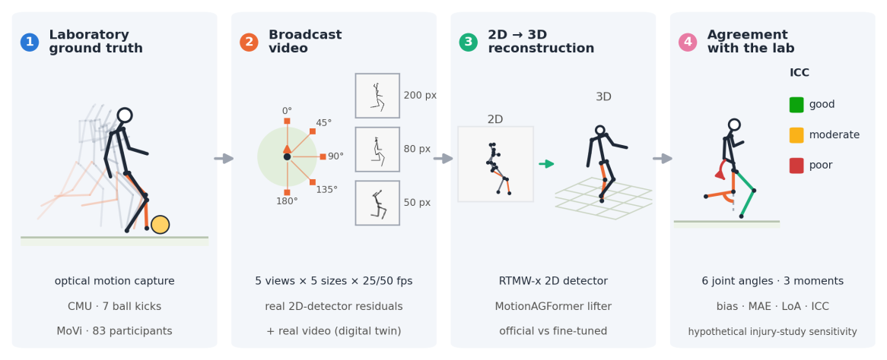
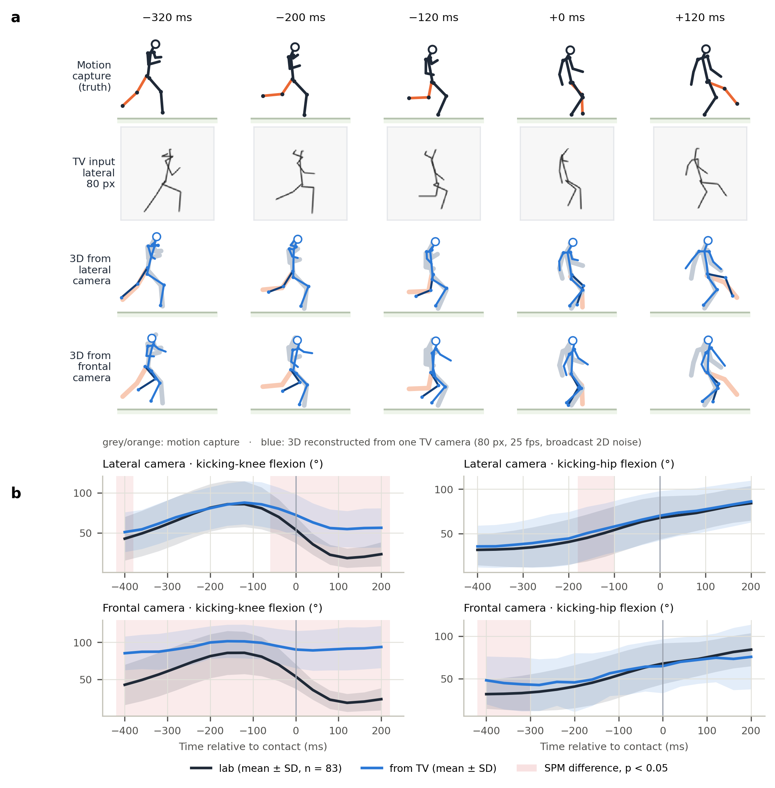

# Kick biomechanics from broadcast video: what can television really measure?

*[Versión en español](README_es.md)*

**Roberto Martín Gutiérrez** · [ORCID 0009-0004-5724-3502](https://orcid.org/0009-0004-5724-3502) · [LinkedIn](https://www.linkedin.com/in/roberto-martín-gutiérrez-ingeniería-biomédica) · convderover@gmail.com

A validation study, against optical motion capture, of the kicking biomechanics and of the **swing-leg joint loads** that a single broadcast camera can deliver in football. It is meant as a complement to the connected ball (LaLiga's xBALL): the sensor measures the ball, this measures the body.



## Main findings

- **2D detector error on broadcast shots** (RTMW-x, 200 Premier League shots): 7.6–12.9 % of player height, more than twice the error on laboratory video of the same pixel size. Model: σ(H) = √((0.063 H)² + 3.9²) px.
- **Typical broadcast condition** (player 80 px tall, 25 fps, replay views): leg-angle errors of 16–20°. Only kicking-knee peak flexion (ICC 0.64) and backswing hip extension (ICC 0.55) reach moderate between-player agreement.
- **Fitness for use** (literature-based criteria): from a single camera no variable is fit for comparison with laboratory norms, ranking players or monitoring an individual. Fusing three replays with a lab-learnt correction makes kicking-knee flexion fit for ranking players (ICC 0.80) and trunk leans comparable with lab norms (MAE < 5°); nothing can monitor individual changes.
- **What matters and what does not:** camera view and knowing the contact instant matter (the connected ball's contact time cuts errors by 25 %); 50 versus 25 fps does not. Independent Gaussian noise overstates the error 1.05–1.8× with respect to real detector residuals.
- **Digital twin:** simulating each real recording with its own camera geometry predicts the real-video error (r = 0.84, mean discrepancy 3.9°).
- **Remedies:** fusing three replay angles raises hip-extension agreement from 0.40 to 0.78; a lifter fine-tuned on kicks under broadcast noise halves simulated errors (MPJPE −62 %) but degrades real ball kicks.
- **Joint load ("joint suffering") score:** valid in the laboratory (ρ = 0.79 with kick intensity) but not recoverable from broadcast-like video (reliability λ = 0.08). Validating it as an injury predictor would need about 590 kicking-related injuries (12–24 LaLiga seasons), against 48 with a laboratory-grade measurement.





## Contents

| Path | What it is |
|:--|:--|
| `docs/manuscrito/manuscript.pdf` / `.docx` | Manuscript (English) |
| `docs/manuscrito/manuscrito_es.pdf` / `.docx` | Manuscript (Spanish) |
| `docs/dossier/dossier_clubes.pdf` | Two-page summary for clubs (Spanish) |
| `resultados/paper/`, `resultados/paper_es/` | All figures in English and Spanish, and the aggregated tables (`table*.csv`) |
| `resultados/videos/` | Explanatory videos (H.264): summary, ball contact, virtual camera, 3D reconstruction, joint load |
| `resultados/error2d_3dsp.csv` | **Broadcast 2D-residual bank** (numbers only, no images): reproduce broadcast noise without the 3DSP images |
| `golpeo/` | Library: virtual camera, residual bank, lifter wrapper, kinematics, swing-leg inverse dynamics, agreement statistics |
| `tests/` | 59 unit tests (`python -m pytest -q`) |

Pipeline:

```
CMU (7 ball kicks, 120 Hz)   MoVi (83 participants, 3D + 2 calibrated video cameras)   3DSP (200 broadcast shots)
          └──────────────┬──────────────┘                                                    │
             golpeo/ensayos.py, cinematica.py (6 features), carga.py (swing-leg moments)  medir_error_2d.py
                         │                                                         → error2d_3dsp.csv (residual bank)
  experimento_sensibilidad.py: virtual camera + residuals → MotionAGFormer → features and loads vs. lab
  validar_video_movi.py: YOLOX + RTMW-x on real video downscaled to broadcast sizes
  gemelo_movi.py: digital twin of every real recording
  ajustar_elevador.py / evaluar_ajuste.py: kick- and broadcast-adapted lifter, cross-validated by subject
                         │
  informe_sensibilidad.py, analisis_carga.py, aceptabilidad.py (fitness for use, TOST),
  ondas_movi.py, figuras_articulo.py (incl. SPM of the waveforms) → figures and tables (EN + ES)
  videos.py → videos · generar_documentos.py → PDF and Word documents
```

## Reproducing the study

```bash
pip install -r requirements.txt
pip install torch==2.10.0 --index-url https://download.pytorch.org/whl/cu128
pip install rtmlib==0.0.16 --no-deps
python descargar_recursos.py            # ~500 MB: models, 3DSP and CMU
python descargar_movi.py 3d             # 3.8 GB: MoVi 3D (non-commercial licence; register first)
python descargar_movi.py video todos    # ~41 GB: MoVi fixed-camera video
python -m pytest -q
python comparar_contacto_cmu.py
python medir_error_2d.py 1              # ~2.5 min on GPU
python experimento_sensibilidad.py      # ~1 h on GPU
python validar_video_movi.py            # ~2 h on GPU
python gemelo_movi.py
python ajustar_elevador.py 0            # optional: fine-tuned lifter, fold 0 (~30 min on GPU)
python ajustar_elevador.py 1            # fold 1
python evaluar_ajuste.py
python informe_sensibilidad.py
python analisis_carga.py
python aceptabilidad.py
python ondas_movi.py
python figuras_articulo.py
python videos.py
python generar_documentos.py
```

Tested on Windows 11, Python 3.11, NVIDIA RTX 5060 (8 GB). Behind a proxy with its own certificate, install `truststore`; the downloaders use it automatically.

## Using it as a benchmark for another model

Any 2D-to-3D lifter can be evaluated on exactly the same 2D input as the official MotionAGFormer:

```bash
python experimento_sensibilidad.py todo --rapido --elevadores oficial,path/to/weights.pth.tr --salida my_model
python validar_video_movi.py --elevador path/to/weights.pth.tr --salida my_model_video
```

Weights must have the MotionAGFormer-B architecture; for a different model, write a class with a `lift_person(uv, conf)` method like the one in `golpeo/elevador.py`.

## Data, licences and what is not in this repository

The datasets are not redistributed. Download them from their owners and cite them:

- **CMU Graphics Lab Motion Capture Database:** free for research.
- **MoVi** (Ghorbani et al. 2021): non-commercial research only, no redistribution. For that reason this repository contains **no per-participant results derived from MoVi** (they are regenerated by the scripts), no MoVi video frames and no weights fine-tuned on MoVi.
- **3D Shot Posture (3DSP)** / SoccerNet: broadcast images are copyrighted; no broadcast image appears in the figures, videos or documents. Only the numerical residual bank is shared.
- Models: RTMW-x and YOLOX (OpenMMLab) and MotionAGFormer, downloaded from their authors under their own licences.

Full references are in `docs/manuscrito/referencias.bib`.

## Citation

See `CITATION.cff`. Until the article is published, please cite this repository.

## Licence

Code: MIT (see `LICENSE`). Text, figures and videos: CC BY 4.0.

This work was carried out independently by the author and is not affiliated with, nor funded by, any institution.
