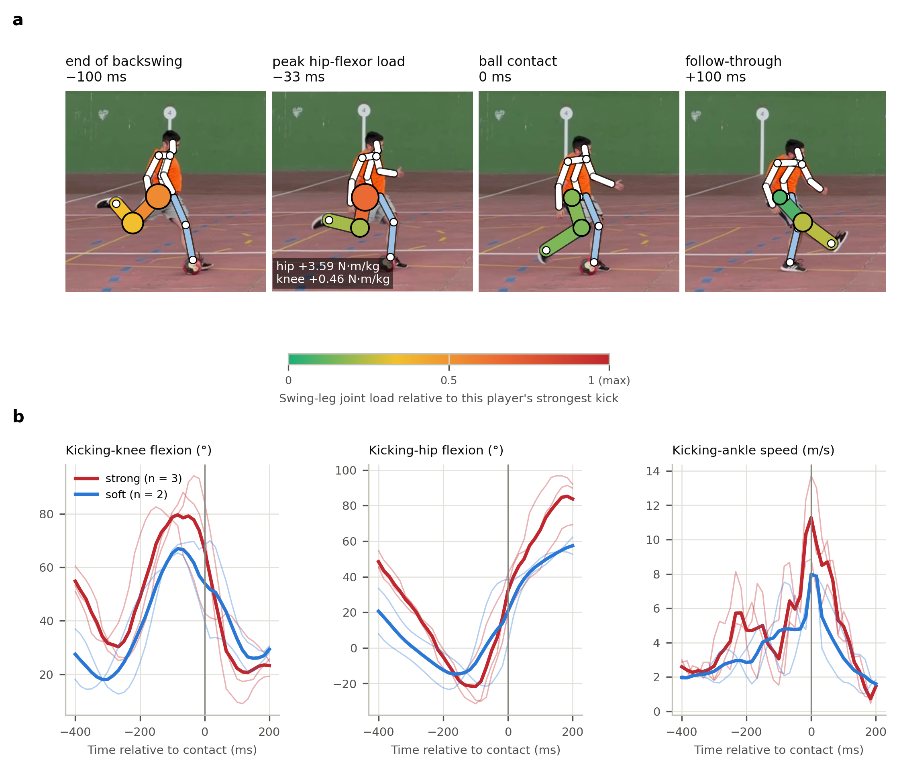

# Kick biomechanics from broadcast video: what can television really measure?

*[Versión en español](README_es.md)*

[](https://doi.org/10.5281/zenodo.23439408)

**Roberto Martín Gutiérrez** · [ORCID 0009-0004-5724-3502](https://orcid.org/0009-0004-5724-3502) · [LinkedIn](https://www.linkedin.com/in/roberto-martín-gutiérrez-ingeniería-biomédica) · convderover@gmail.com

## Published preprint — SportRxiv, 26 October 2026

**What can be measured from the broadcast? Validity of single-camera video for football-kick kinematics and swing-leg joint loads**

Roberto Martín Gutiérrez · **Preprint; not peer reviewed.**

[Preprint DOI: 10.51224/SportRxiv.1131](https://doi.org/10.51224/SportRxiv.1131) · [Public publication page (1131)](https://sportrxiv.org/index.php/server/preprint/view/1131) · [Published PDF](docs/preprint/Martin-Gutierrez_2026_broadcast_kick_biomechanics_preprint.pdf)

The original **software and research-data release v1.0.0**, dated 17 October 2026, remains archived separately at [Zenodo: 10.5281/zenodo.23439408](https://doi.org/10.5281/zenodo.23439408). These DOIs identify different research outputs. The Zenodo archive is unchanged.

A method-comparison study against optical motion capture of football-kick kinematics and **model-derived swing-leg joint loads** estimated from single-camera video under broadcast-like conditions. Ball-contact timing motivates future work with connected-ball systems, but this study did not validate a synchronised connected-ball deployment.

**Scope of validation.** Benchmark evaluations use reference information for reconstruction scale and rigid alignment; the principal condition also uses reference event time and kicking side. This is a reference-assisted benchmark, not a complete independent validation of a deployed system on real match broadcasts. The simplified load model is shared by the laboratory reference and the video estimate.


## Main findings

- **2D detector error on broadcast shots** (RTMW-x, 200 Premier League shots): 7.6–12.9 % of player height, more than twice the error on laboratory video of the same pixel size. Model: σ(H) = √((0.063 H)² + 3.9²) px.
- **Typical simulated broadcast condition** (player 80 px tall, 25 fps, known contact, replay views 45–135°): leg-angle errors of 16–20°. Only kicking-knee peak flexion (ICC 0.64) and backswing hip extension (ICC 0.55) reach moderate between-player agreement.
- **Exploratory acceptability criteria:** no variable from a single simulated camera met the selected criteria. Three simulated replays with laboratory-learned bias correction met the between-participant ranking criterion for kicking-knee peak flexion (ICC 0.80; 95% CI 0.70–0.87) and the laboratory-comparison criterion for trunk leans (MAE < 5°). These criteria are not validated clinical or sporting decision thresholds. Repeated-session individual monitoring was not validated.
- **View and event timing:** using the reference contact instant reduced leg-feature errors by about 25% relative to the automatic event estimate. The tested 50-versus-25-fps contrast did not improve results. Connected-ball timing accuracy and video synchronisation were not evaluated. Independent Gaussian noise overstated error 1.05–1.8× relative to real detector residuals.
- **Digital twin:** simulating each real recording with its own camera geometry predicts aggregate real MoVi-video errors (r = 0.84, mean discrepancy 3.9°).
- **Remedies:** fusing three replay angles raises hip-extension agreement from 0.40 to 0.78; a lifter fine-tuned on kicks under broadcast noise (tested on unseen participants and held-out broadcast residuals) cuts simulated errors from 14.7° to 8.3° and meets the exploratory ranking criterion for kicking-hip range of motion on real MoVi video at 80 px, but worsens performance on the small CMU ball-kick sample.
- **Kick Load Index (KLI):** Spearman ρ ≈ 0.79 with ankle speed in laboratory data is an internal consistency check of a simplified model with shared kinematic inputs, not independent clinical validation. Agreement for video-derived KLI in the typical simulated condition was poor (ICC ≈ 0.09). Injury prediction has not been demonstrated. The calibration slope is not a reliability estimate; event-count illustrations use only independently assumed information fractions and do not estimate a required injury cohort or league seasons.

- **Field example** (the author's own ball kicks filmed with a smartphone, 13 kicks, 4 views): strong and soft kicks are told apart by ankle speed (12.0 vs 8.7 m/s) and posture from side and rear-diagonal views but not from the front, and inverse-dynamics loads from video are implausible — an illustrative plausibility check without a reference measurement, not a validity or injury-risk test.




## Study samples

- **CMU:** 7 ball kicks from 2 participants.
- **MoVi principal analysis:** 83 participants (one air kick per participant).
- **Real MoVi video:** 162 usable recordings from 82 participants.
- **3DSP:** 200 broadcast shots.
- **Field example:** 13 smartphone-recorded kicks by the author, without motion-capture reference.

## Contents

| Path | What it is |
|:--|:--|
| `docs/preprint/` | Published SportRxiv preprint and supplementary materials; authoritative publication version |
| `docs/manuscrito/manuscript.pdf` / `.docx` | Local English manuscript derivatives; see [version status](docs/PUBLICATION_VERSION.md) |
| `docs/manuscrito/manuscrito_es.pdf` / `.docx` | Local Spanish manuscript derivatives; see [version status](docs/PUBLICATION_VERSION.md) |
| `docs/dossier/dossier_clubes.pdf` | Spanish club summary; see [version status](docs/PUBLICATION_VERSION.md) |
| `resultados/paper/`, `resultados/paper_es/` | All figures in English and Spanish, and the aggregated tables (`table*.csv`) |
| `resultados/videos/` | Explanatory videos (H.264): summary, ball contact, virtual camera, 3D reconstruction, joint load, and the author's real kick in slow motion (07) |
| `resultados/error2d_3dsp.csv` | **Broadcast 2D-residual bank** (numbers only, no images): reproduce broadcast noise without the 3DSP images |
| `golpeo/` | Library: virtual camera, residual bank, lifter wrapper, kinematics, swing-leg inverse dynamics, agreement statistics |
| `tests/` | Unit tests (`python -m pytest -q`) |

Pipeline:

```
CMU (7 ball kicks, 120 Hz)   MoVi (83 participants, 3D + 2 calibrated video cameras)   3DSP (200 broadcast shots)
          └──────────────┬──────────────┘                                                    │
             golpeo/ensayos.py, cinematica.py (6 features), carga.py (swing-leg moments)  medir_error_2d.py
                         │                                                         → error2d_3dsp.csv (residual bank)
  experimento_sensibilidad.py: virtual camera + residuals → MotionAGFormer → features and loads vs. lab
  validar_video_movi.py: YOLOX + RTMW-x on real video downscaled to broadcast sizes
  gemelo_movi.py: digital twin of every real recording
  ajustar_elevador.py / evaluar_ajuste.py: kick- and broadcast-adapted lifter, cross-validated by subject
                         │
  informe_sensibilidad.py, analisis_carga.py, aceptabilidad.py (fitness for use, TOST),
  ondas_movi.py, figuras_articulo.py (incl. custom waveform permutation analysis) → figures and tables (EN + ES)
  campo_videos.py, figuras_campo.py: field example with the author's smartphone kicks (videos not included)
  videos.py → videos · generar_documentos.py → PDF and Word documents
```

## Publication versions

The exact published preprint and supplementary PDF are preserved in `docs/preprint/`. Maintained reading versions and explanatory materials in this repository are separate derivatives. See [version status and scientific corrections](docs/PUBLICATION_VERSION.md) before using local PDFs, Word documents, figures or videos.

## Reproducing the study

```bash
pip install -r requirements.txt
pip install torch==2.10.0 --index-url https://download.pytorch.org/whl/cu128
pip install rtmlib==0.0.16 --no-deps
python descargar_recursos.py            # ~500 MB: models, 3DSP and CMU
python descargar_movi.py 3d             # 3.8 GB: MoVi 3D (non-commercial licence; register first)
python descargar_movi.py video todos    # ~41 GB: MoVi fixed-camera video
python -m pytest -q
python comparar_contacto_cmu.py
python medir_error_2d.py 1              # ~2.5 min on GPU
python experimento_sensibilidad.py      # ~1 h on GPU
python validar_video_movi.py            # ~2 h on GPU
python gemelo_movi.py
python ajustar_elevador.py 0            # optional: fine-tuned lifter, fold 0 (~30 min on GPU)
python ajustar_elevador.py 1            # fold 1
python evaluar_ajuste.py
python informe_sensibilidad.py
python analisis_carga.py
python aceptabilidad.py
python ondas_movi.py
python figuras_articulo.py
python videos.py
python generar_documentos.py
```

Tested on Windows 11, Python 3.11, NVIDIA RTX 5060 (8 GB). Behind a proxy with its own certificate, install `truststore`; the downloaders use it automatically.

## Using it as a benchmark for another model

Any 2D-to-3D lifter can be evaluated on exactly the same 2D input as the official MotionAGFormer:

```bash
python experimento_sensibilidad.py todo --rapido --elevadores oficial,path/to/weights.pth.tr --salida my_model
python validar_video_movi.py --elevador path/to/weights.pth.tr --salida my_model_video
```

Weights must have the MotionAGFormer-B architecture; for a different model, write a class with a `lift_person(uv, conf)` method like the one in `golpeo/elevador.py`.

## Data, licences and what is not in this repository

The datasets are not redistributed. Download them from their owners and cite them:

- **CMU Graphics Lab Motion Capture Database:** free for research.
- **MoVi** (Ghorbani et al. 2021): non-commercial research only, no redistribution. For that reason this repository contains **no per-participant results derived from MoVi** (they are regenerated by the scripts), no MoVi video frames and no weights fine-tuned on MoVi.
- **3D Shot Posture (3DSP)** / SoccerNet: broadcast images are copyrighted; no broadcast image appears in the figures, videos or documents. Only the numerical residual bank is shared.
- Models: RTMW-x and YOLOX (OpenMMLab) and MotionAGFormer, downloaded from their authors under their own licences.

Full references are in `docs/manuscrito/referencias.bib`.

## Citation

**Preprint:** Martín Gutiérrez, R. (2026). *What can be measured from the broadcast? Validity of single-camera video for football-kick kinematics and swing-leg joint loads*. SportRxiv. https://doi.org/10.51224/SportRxiv.1131 (Posted 26 October 2026; not peer reviewed).

**Original software/data release:** Martín Gutiérrez, R. (2026). *Kick biomechanics from broadcast video: a validation study of kinematics and swing-leg joint loads against optical motion capture* (v1.0.0) [Software]. Zenodo. https://doi.org/10.5281/zenodo.23439408

`CITATION.cff` preserves the original software title, version, date and Zenodo DOI; its `preferred-citation` identifies the published preprint separately. Cite the preprint for the study and the archived version when using that software/data release.

## Licence

Code: MIT (see `LICENSE`). Text, figures and videos: CC BY 4.0.

This work was carried out independently by the author and is not affiliated with, nor funded by, any institution.
