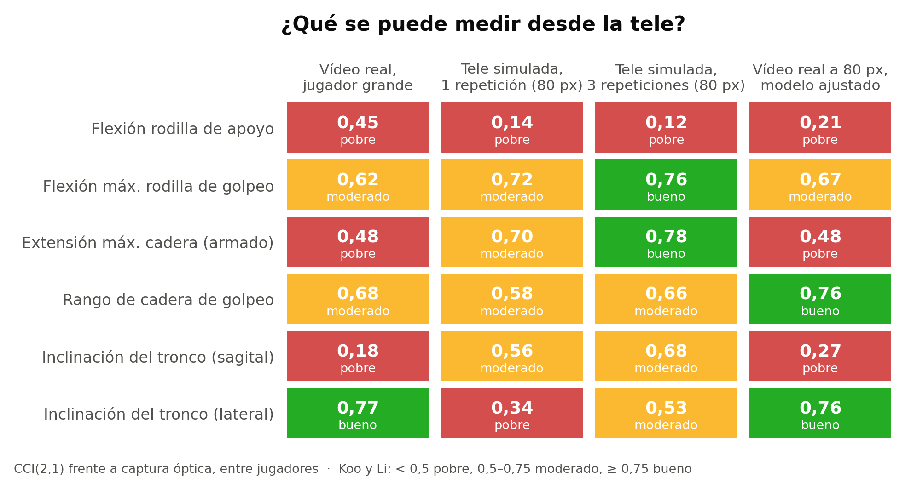

**Roberto Martín Gutiérrez** · Ingeniero biomédico (Grado y Máster, Universidad de Valladolid) · ORCID 0009-0004-5724-3502
convderover@gmail.com · www.linkedin.com/in/roberto-martín-gutiérrez-ingeniería-biomédica

# En una frase

El balón conectado de LaLiga mide el balón; este trabajo mide **el cuerpo que lo golpea desde la tele**, y es el primero en cuantificar, frente a captura óptica, **cuánto se puede fiar un club** de esas medidas.

# Qué he hecho

- **Error real del detector en emisiones de fútbol:** 6.000 detecciones en 200 disparos de la Premier League.
- **Verdad de laboratorio:** 90 golpeos (7 de balón con carrera y 83 personas), con captura óptica a 120 Hz.
- **Cámara de TV virtual:** 5 ángulos, jugador de 400 a 50 px, 25/50 fps, con el error real de la retransmisión.
- **Vídeo real con 3D sincronizada** y un **gemelo digital** que comprueba que el simulador acierta.
- **Carga articular de la pierna de golpeo** (cadera y rodilla) por dinámica inversa, sin plataformas de fuerza.
- **Tres remedios evaluados:** corrección de sesgos, fusión de repeticiones y un modelo 3D adaptado al golpeo con ruido de retransmisión.
- **Código abierto y verificado:** 59 tests y protocolo publicable como banco de pruebas.

# Qué es fiable desde la tele

{width=88%}

**Lectura para un club:**

- **Con una cámara y modelos abiertos, los ángulos de la pierna de un disparo concreto tienen 15–20° de error:** sirven para tendencias de un jugador con muchos disparos, no para juzgar un disparo aislado.
- **Lo más medible:** la flexión de la rodilla de golpeo y la extensión de cadera en el armado (acuerdo moderado; bueno si se combinan 3 repeticiones). **La rodilla de apoyo no es medible desde la tele.**
- **La frecuencia de imagen no es el problema** (25 frente a 50 fps: sin diferencia). Lo son el tamaño del jugador, el ángulo de cámara y saber cuándo toca el balón.
- **El instante de contacto del balón conectado reduce el error un 25 %.** Cuerpo + xBALL es mejor que cualquiera de los dos por separado.
- **El simulador está validado:** predice el error medido con imagen real (r = 0,84, ~4° de diferencia).
- **Adaptar el modelo 3D al golpeo:**
  - **Con golpeos al aire:** reduce el error a la mitad en simulación y mejora 5 de 6 rasgos en vídeo real.
  - **Con golpeos reales con balón:** **empeora**.
  - **Lo que implica:** hacen falta golpeos de fútbol del propio club para entrenar y validar. Es la tercera prueba independiente de lo mismo.

# ¿Y un índice de "sufrimiento articular" o de riesgo de lesión?

- **En laboratorio sí funciona:** el índice de carga del golpeo crece con la intensidad del disparo (ρ = 0,79 en 83 personas). Además refleja la carga de flexores de cadera y cuádriceps, ligada a las roturas de recto femoral y aductores. Aductores y cuádriceps suman el 42 % de las lesiones musculares del fútbol profesional.
- **Desde la tele, hoy no:** la fiabilidad cae a λ ≈ 0,08 (≈ 0,38 con un sustituto postural).
- **Cuánto cuesta validarlo como predictor:** con medida de laboratorio harían falta unas 48 lesiones, 1–2 temporadas de LaLiga. Con la medida actual de TV harían falta unas 590, unas 12–24 temporadas.
- **Conclusión práctica:** primero subir la fiabilidad con datos de fútbol del propio club; después, el estudio de lesiones.

# Qué puedo aportar a un club o a LaLiga

1. **Auditoría de métricas de proveedores:** cualquier métrica de técnica o carga se valida en horas con este protocolo.
2. **Fase 2 con datos del club:** vídeo de partidos y entrenamientos + xBALL + sesiones de captura del propio equipo para adaptar el modelo al fútbol. El primer entregable es un informe de fiabilidad por rasgo y cámara.
3. **Estudio prospectivo con el cuerpo médico:** solo con los rasgos que lleguen a fiabilidad buena (λ ≥ 0,75), para que el estudio quepa en 1–2 temporadas.

**Material:** artículo (preprint en inglés), código, vídeos explicativos y figuras en {{REPO_URL}}. Las imágenes de retransmisión y las de MoVi no se publican por licencia.
