**Maintained repository reading version.** The preprint published on SportRxiv on 26 October 2026 ([DOI 10.51224/SportRxiv.1131](https://doi.org/10.51224/SportRxiv.1131)) is the version of record for this preprint and is not peer reviewed. This source incorporates its scientific corrections; it is not an identical copy of the published PDF. See [version status](../PUBLICATION_VERSION.md).

**Author.** Roberto Martín Gutiérrez^1^ (corresponding author). ^1^ Independent researcher, Spain. ORCID: [0009-0004-5724-3502](https://orcid.org/0009-0004-5724-3502). E-mail: convderover@gmail.com. LinkedIn: roberto-martín-gutiérrez-ingeniería-biomédica.

**Article type:** Original Investigation. **Running title:** Kick biomechanics from broadcast video. **Word count (main text):** {{WORDS}}.

# Abstract

This method-comparison study examined agreement of single-camera broadcast-like estimates of football-kick kinematics and swing-leg joint moments with optical motion capture. Reference data comprised seven CMU ball kicks from two participants and 83 MoVi air kicks. Detector residuals came from 200 Premier League shots; real-video validation used 162 recordings from 82 MoVi participants. Six kinematic features and three model-derived moments were assessed using absolute error, agreement and exploratory operational criteria. Broadcast detector error was 7.6–12.9% of player height. In the typical simulated condition (80 px, 25 fps, known contact and replay views), no single-camera variable met the selected criteria (highest ICC 0.64). The digital twin predicted aggregate real-video errors (r = 0.84). Three simulated replays with laboratory bias correction met the ranking criterion for kicking-knee flexion (ICC 0.80) and the laboratory-comparison criterion for trunk leans. KLI correlated with laboratory ankle speed (Spearman ρ = 0.79), a shared-input model-consistency check, but broadcast agreement was poor (ICC 0.090). Adaptation improved unseen air kicks but worsened CMU ball kicks. Thirteen smartphone recordings provided an illustrative field example without a reference. These findings support cautious benchmarking and further football-specific validation; current estimates do not support individual clinical, scouting or injury-risk decisions.

**Keywords:** football; kicking; broadcast video; markerless motion capture; agreement; inverse dynamics

# 1. Introduction

Kicking defines football and is also a mechanism of injury. Muscle injuries account for almost one third of time-loss injuries in men's professional football, with adductor (23 %) and quadriceps (19 %) injuries prominent [@ekstrand2011], and hip and groin injuries represent 12–16 % of all injuries every season [@werner2009; @werner2019]. Kicking is one of the two main actions behind acute adductor longus injuries [@serner2019] and a principal mechanism of rectus femoris strains [@mendiguchia2013]. The biomechanics of the kick — the backswing that stretches the hip flexors, the rapid knee extension and the braking of the shank before impact — is well described in the laboratory [@lees2010; @kellis2007; @nunome2002; @dorge2002; @apriantono2006; @shan2005; @charnock2009].

In matches, however, the kick is only observed through broadcast video. Since August 2026 LaLiga EA Sports instruments every match ball with a sensor that reports the instant of every touch [@laliga2026]: the ball is measured, the body that strikes it is not. Monocular pose estimation now extracts kicking posture from a single camera: AutoSoccerPose builds 2D and 3D shot-posture sequences from broadcast footage [@yeung2024], Noworolnik and Jaworek-Korjakowska rate shooting technique from side-view features [@noworolnik2025], and 3D player pose from broadcasts is an active topic [@jiang2024worldpose; @khan2026; @baumgartner2023].

What is missing is the measurement error of the kicking variables themselves under broadcast conditions. Markerless systems have been validated with several laboratory cameras [@kanko2021; @needham2021; @uhlrich2023] and for kicking against manual digitisation [@palucci2022], but a broadcast camera is different: shooters often occupy 30–90 pixels, the camera angle is arbitrary, the frame rate is 25 or 50 fps and images are compressed. In athletic movements monocular joint angles can correlate with motion capture while joint velocities do not [@yeung2025]; joint loads, which need second derivatives of position, should be even more fragile — yet they are what a medical department would want for a "joint suffering" or injury-risk score. Without a known measurement error, broadcast-derived technique or load metrics cannot be interpreted, and injury models built on them cannot be validated.

Our research question was: for which practical uses — comparison with laboratory norms, ranking players or monitoring an individual — are kicking kinematics and swing-leg joint loads estimated from single-camera broadcast-like video acceptable, and how large would a study validating a broadcast-derived load score as an injury predictor have to be? We also quantified the real 2D detector error on broadcast shots, tested the simulation against real video, and evaluated three remedies.

# 2. Methods

## 2.1 Design, data and reporting

This was a method-comparison (agreement) study using secondary analysis of public datasets, complemented by a field example (Section 2.6), with optical motion capture as the reference (Figure {{fig:design}}, Table {{tbl:data}}). A virtual broadcast camera filmed each laboratory kick at controlled player sizes, views and frame rates, its exact 2D projections were corrupted with the error a detector actually makes on broadcast shots, and a temporal lifter reconstructed 3D, from which features and loads were recomputed. The same pipeline ran on real video with synchronised capture, and each real recording was reproduced by its digital twin. Reporting follows the Guidelines for Reporting Reliability and Agreement Studies (GRRAS) [@kottner2011] (checklist in the supplementary material). The study was not pre-registered.

![Study design. (1) Laboratory kicks recorded with optical motion capture provide the ground truth (shown: a CMU ball kick, fading poses up to ball contact). (2) A virtual broadcast camera films each kick from five views at five player sizes and 25 or 50 fps (insets: the same instant at 200, 80 and 50 px), and its exact 2D projections are corrupted with the residuals that a detector makes on real broadcast shots; real video with synchronised capture (MoVi) and a digital twin of each recording test the simulation. (3) The 2D keypoints are lifted to 3D with MotionAGFormer, with official or kick-adapted weights. (4) Six kinematic features and three swing-leg joint moments are compared with the laboratory (bias, mean absolute error, limits of agreement, ICC with the classes of Koo and Li), and hypothetical injury-study event counts are illustrated under independent assumptions about information fraction q.](../../resultados/paper/fig1_design.png){#fig:design width=100%}

**CMU (ball kicks).** Seven trials labelled "soccer – kick ball" from the CMU Graphics Lab Motion Capture Database [@cmu] (subject 10, trials 01–06; subject 11, trial 01; Vicon, 120 Hz), using the virtual joint centres of the capture software. Six trials have three ball markers; 11_01 includes a run-up; 10_04 is a slow kick (peak ankle speed 4.1 m/s versus 10.2–13.1 m/s).

**MoVi (multi-participant, with video).** The F round of MoVi [@ghorbani2021] contains, for 90 participants, one kicking action captured at 120 Hz and processed with Visual3D, with synchronised video from two calibrated stationary cameras (800 × 600 px, 30 fps), height and body mass. Joints stored as (0, 0, 0) were treated as gaps; gaps up to 0.25 s were interpolated and kicks with longer gaps excluded, leaving 83 participants (55 female). These are air kicks by non-footballers, so they validate the measurement chain rather than describe football technique. Synchronisation (capture frame = 4 × video frame) was verified by projecting the capture onto the detections (offset 0 ± 2 capture frames).

: Data sets used. {#tbl:data}

| Data set | Role | Size | Rate | Notes |
|:--------|:--------------|:----------------|:-------|:----------------|
| CMU | Ground truth: real ball kicks | 2 participants, 7 kicks | 120 Hz | Vicon; ball markers in 6 kicks; one with run-up |
| MoVi (round F) | Ground truth and real video | 83 participants, 83 air kicks, 2 cameras | 120 Hz; video 30 fps | Visual3D; height and mass; non-commercial licence |
| 3DSP | Broadcast 2D detector error | 200 Premier League shots, 6 000 detections | 25 fps | Manual 2D annotation of the shooter |

## 2.2 Kinematic features and swing-leg joint loads

The kicking leg is the one whose ankle reaches the higher peak speed, and contact is approximated by the peak of kicking-ankle speed; in the CMU trials with ball markers we compared it with the true contact, obtained by extrapolating the ball's launch line back to its resting position. Six features were computed from an eight-joint skeleton (shoulders, hips, knees, ankles; Figure {{fig:model}}a–d): support-knee flexion at contact; kicking-knee peak flexion and kicking-hip peak extension (−0.3 s to contact); kicking-hip range of motion (−0.3 to +0.2 s); and trunk sagittal and lateral lean at contact. These overlap with previous single-camera pipelines [@noworolnik2025] and with determinants of kick performance [@lees2010; @kellis2007].

Between the end of the backswing and ball contact the kicking leg does not touch the ground, so the net moments at its knee and hip are determined by the kinematics and inertia of thigh, shank and foot (Figure {{fig:model}}e). We used a Newton–Euler model with the body-segment parameters of de Leva [-@deleva1996], the foot as a point mass at the ankle (broadcast skeletons have no foot points) and segment angular velocity from the longitudinal axis (ω = u × u̇). Moments were projected onto the pelvis lateral axis (positive: knee extensor, hip flexor) after zero-lag Butterworth filtering (12 Hz, or 0.35 × fps if lower). Three peaks normalised by body mass were extracted: peak hip-flexor and knee-extensor moments from the end of the backswing to contact, and peak knee-flexor (braking) moment in the 100 ms before contact; a Kick Load Index (KLI) is their mean expressed as z-scores relative to the MoVi laboratory distribution. The model was verified analytically (static limb, mirror symmetry, quadratic scaling with speed) and was identical for reference and estimate, so the comparison isolates the measurement chain. On a full and a slow kick by the same player it gives 1.01 versus 0.43 N·m/kg of hip-flexor moment and 0.89 versus 0.12 N·m/kg of knee-flexor moment (Figure {{fig:model}}f).

![The kick model on a real ball kick (CMU 10_01, 120 Hz). (a–d) Five of the six kinematic features read from the skeleton (the sixth is the kicking-hip range of motion): kicking-hip extension at the end of the backswing (a), kicking-knee peak flexion (b), support-knee flexion and trunk sagittal lean at ball contact (c) and trunk lateral lean at contact (d); orange: kicking leg; green: support leg. (e) Free-body diagram of the swing leg 50 ms before contact: segment weights at the centres of mass, hip reaction force and net joint moments. (f) Net hip and knee moments of this kick and of a slow kick by the same player (10_04, dashed); grey band: end of backswing to contact; orange band: last 100 ms; dots: the three load peaks used as variables.](../../resultados/paper/fig2_model.png){#fig:model width=100%}

## 2.3 Broadcast 2D error, virtual camera and 3D lifting

We used the 3D Shot Posture dataset (3DSP) [@yeung2024]: 200 shots from English Premier League broadcasts (via SoccerNet [@deliege2021]), 20 consecutive frames at 25 fps, with 17 manually annotated keypoints of the shooter. RTMW-x [@jiang2024rtmw; @jiang2023rtmpose] was run inside the annotated person box, also at 75 % and 50 % scale for a quarter of the shots (6 000 detections). We report the RMS error per axis as a function of player height *H* and fit σ(*H*) = √((*aH*)² + *b*²), an upper bound of detector error because annotations have their own error.

Each ground-truth kick was resampled to 25 or 50 fps and filmed by a pinhole camera 40 m away at 15° elevation and azimuths of 0° (frontal), 45°, 90° (lateral, kicking-leg side), 135° and 180°, with *H* ∈ {400, 200, 120, 80, 50} px. Three 2D error models were added: none; independent Gaussian noise with the measured σ(*H*); and a bootstrap of whole 20-frame sequences of real RTMW residuals from 3DSP, scaled by *H*, which preserves temporal correlation and gross failures such as left–right swaps.

We lifted 2D to 3D with MotionAGFormer-B and its official Human3.6M weights [@mehraban2024; @ionescu2014]. Two details had first-order effects: the 2D input must be normalised in a crop centred on the player, because full-frame normalisation, as in the public demo, yields 50–90° errors for small players even without noise; and RTMW scores are not probabilities, so they were replaced by a constant confidence of 0.9 (passing them unchanged under-estimated kicking-knee flexion by 41°). The reconstruction used reference thigh length for scale and one rigid alignment per sequence to the reference. These are optimistic reference-assisted conditions, not a demonstrated match-video pitch-calibration procedure. The kicking leg was supplied from the reference. Known contact used the laboratory event; automatic contact used the reconstructed ankle-speed peak. These choices isolate parts of the measurement chain and do not validate autonomous camera calibration, limb identification or sensor synchronisation in matches.

## 2.4 Real video and digital twin

**Usable real video:** 162 recordings from 82 participants; two participants contributed only one usable camera.

Real-video analyses included 162 recordings from 82 participants (two participants had only one usable camera). For each usable MoVi participant and camera, YOLOX-m [@ge2021yolox] detected the person; images were downscaled so that the participant measured 120, 80 or 50 px and JPEG-compressed, or kept at native resolution (about 330 px), and RTMW-x estimated the pose. In the digital twin, each recording was re-simulated at exactly its calibrated geometry and frames with three 2D error models: none, real RTMW residuals from the *other* MoVi participants, and broadcast residuals. Agreement between simulated and real errors tests the simulation within the MoVi laboratory domain; transfer to match video remains unvalidated.

## 2.5 Remedies

*Replay fusion.* We averaged the per-view estimates of two (45°, 135°) or three (45°, 90°, 135°) virtual replays with independent 2D errors. *Bias correction.* A view-specific linear calibration (reference ≈ *a* + *b*·estimate) was learnt on laboratory kicks and applied to unseen participants (leave-one-participant-out), and, to test transfer, learnt on all MoVi kicks and applied to the CMU ball kicks. *Kick- and broadcast-adapted lifter.* MotionAGFormer-B was fine-tuned on synthetic broadcast data generated from MoVi motion capture (all 21 recorded actions; random view, elevation 5–25°, distance 15–60 m, *H* 40–400 px, 25 or 50 fps; broadcast residuals, Gaussian noise or exact projections) for 1 000 iterations with the original loss. Participants were split into two folds and each model was tested only on participants it never saw. The 3DSP shots were split into two halves stratified by player height: training used one half and every virtual-camera test of the adapted lifter the other. CMU ball kicks were never used for training.

## 2.6 Field example

To illustrate the pipeline on genuine football kicks, the author (adult male, 177 cm, 78 kg, recreational right-footed player) performed 13 instep kicks of a stationary ball on an outdoor hard court (8 strong, 5 soft), each filmed once with a smartphone at a fixed position (1920 × 1080 px, 60 fps) from one of four views: lateral (5 kicks), diagonal from behind (4), diagonal from the front (2) and front (2). The player measured 170–241 px (median 199 px). The videos were processed with the same detector and lifter at native resolution and with the player downscaled to 80 px and JPEG-compressed. The reconstruction was scaled with a thigh length of 0.245 × stature [@winter2009], the image vertical was taken as the world vertical (level camera), occasional left–right swaps of knee and ankle labels were corrected by temporal continuity (Viterbi; 20 of 10 200 frames), and contact was the speed peak of the right (kicking) ankle. Without motion capture this example tests plausibility — whether strong and soft kicks are told apart — and consistency across resolutions, not validity.

## 2.7 Statistics and acceptability criteria

For each variable we report bias, mean absolute error (MAE), 95 % limits of agreement [@bland1986], ICC(2,1) for absolute agreement [@shrout1979] with the classes of Koo and Li [@koo2016], and the calibration slope b (regression of the reference on the estimate), with 95 % confidence intervals from 1 000 bootstrap resamples of participants. The *typical broadcast condition* is *H* = 80 px, 25 fps, broadcast residuals, known contact and replay views (45–135°). Sample size was fixed by available datasets, without a prospective precision calculation. The principal simulated analyses contain 249 participant-view pairs from 83 participants, not 249 independent people. Participant-cluster bootstrap resampling retains every view of a sampled participant. Pooled limits of agreement describe this participant-view mixture and do not estimate individual test–retest repeatability. Calibration slope is scale dependent and is not a reliability estimate.

Exploratory operational criteria were applied after the main results were known; these are not validated clinical or sporting decision thresholds. *Laboratory comparison* (angles): MAE ≤ 5° and mean bias equivalent to zero within ±5° (TOST, α = 0.05, one mean difference per participant [@schuirmann1987; @lakens2017]). The margin was motivated by gait literature [@mcginley2009], not a universal football threshold. *Between-participant ranking*: ICC ≥ 0.75 and lower 95% confidence limit ≥ 0.5, informed by ICC interpretation guidance [@koo2016]. *Monitoring proxy*: SD of paired method differences ≤ 0.2 between-participant reference SDs [@hopkins2009]. This screen is not longitudinal validation; repeated sessions and a football-specific meaningful-change threshold would be required.

Laboratory and reconstructed knee and hip waveforms were compared with a custom paired sign-flip permutation procedure informed by functional-data inference [@pataky2012; @pataky2015; @nichols2002]. For each of four waveform comparisons, 10 000 participant-level sign flips generated a maximum-absolute-t threshold controlling the timewise family at α = 0.05; cluster p-values used maximum cluster mass. Correction was within each waveform, not across all four comparisons. These exploratory results were not produced with the spm1d package.

## 2.8 Illustrative injury-study sensitivity

Measurement error can attenuate exposure–outcome associations [@hutcheon2010]. For an illustrative univariable proportional-hazards model with a standardised exposure, α = 0.05 and 80% power, Schoenfeld’s approximation [@schoenfeld1983] is *D* = (*z*~0.975~ + *z*~0.8~)² / (*q* · ln² HR), with independently justified information fraction *q*. Under classical additive nondifferential exposure error, q corresponds to reliability and squared exposure-surrogate correlation. For hypothetical HR = 1.5, q = 1, 0.5, 0.2 and 0.1 gives rounded-up counts of 48, 96, 239 and 478 events. These are not KLI sample-size estimates or league-season forecasts. The scale-dependent calibration slope cannot be substituted for q without establishing the error model. No injury outcomes, clinical effect size or injury incidence were measured.

# 3. Results

## 3.1 Contact instant and broadcast detector error

In the five CMU kicks with ball markers the peak of kicking-ankle speed preceded the true contact by 19.6 ms (6.8–32.2 ms; Supplementary Figure {{figS:contact}}), less than one broadcast frame, and computing the features at that peak changed them by at most 2.1°.

On broadcast shots the detector's RMS error per axis followed σ(*H*) = √((0.063 *H*)² + 3.9²) px, falling from 12.9 % of player height at about 27 px to 7.6 % at about 86 px (Figure {{fig:2d}}a). Ankles (14.4 %) and wrists (13.7 %) were the least accurate joints, hips (5.6 %) and shoulders (5.5 %) the most (Figure {{fig:2d}}b). On laboratory video downscaled to the same sizes the same detector erred by 3.1–4.0 % of *H*: broadcast images are more than twice as hard.

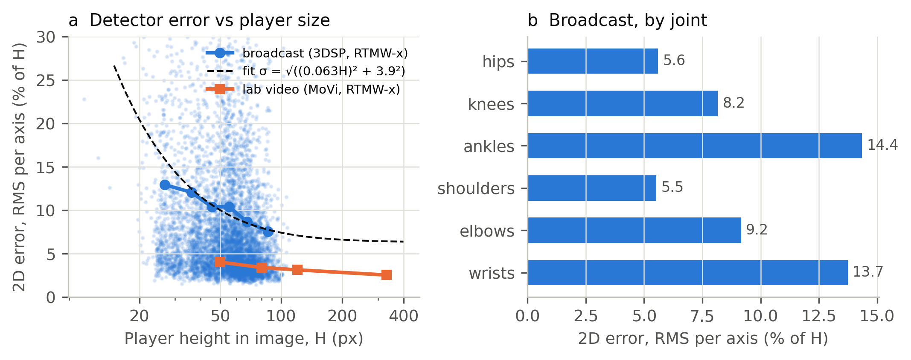{#fig:2d width=100%}

## 3.2 Sensitivity to view, size, frame rate, error model and contact

Without 2D noise the lifter alone produced a mean feature error of 9.2° on the MoVi kicks and 15.0° on the CMU ball kicks; within MoVi the error was unrelated to kick intensity (Spearman ρ = 0.12, *p* = 0.27; Supplementary Figure {{figS:intensity}}). With broadcast residuals the camera view dominated: MoVi errors were 11.9° (lateral), 13.5° (135°), 19.0° (45°), 20.0° (rear) and 22.6° (frontal) (Supplementary Figures {{figS:sens}} and {{figS:senscmu}}). Player size had little effect between 50 and 400 px (16.8–18.2°). Independent Gaussian noise of the measured magnitude over-stated the error of real residual sequences by 1.05–1.8 times; 50 fps did not improve on 25 fps (16.7° versus 17.4°); and detecting the contact from the reconstructed pose instead of knowing it increased the error from 17.4° to 23.1° (Supplementary Figure {{figS:ablation}}).

On the average waveform (Figure {{fig:recon}}), from a lateral camera the reconstructed hip flexion followed the laboratory curve closely (mean difference 3.3°; significant only between −160 and −120 ms, *p* = 0.011), and knee flexion followed it up to peak flexion, but the knee extension through contact was missed: 18° too flexed at contact and 36° 120 ms later (significant from −40 to +200 ms, *p* < 0.001). From a frontal camera the reconstructed knee angle was nearly flat (85–101° against 19–86°; significant over the whole window, *p* < 0.001).

![What the broadcast camera sees and what is reconstructed. (a) A real ball kick (CMU 10_01) at five instants around contact: motion capture (top row); the 2D input of a lateral broadcast camera with the player 80 px tall, 25 fps and real broadcast 2D residuals (second row); and the 3D reconstructed from a lateral and from a frontal camera (blue) superimposed on the truth (grey, kicking leg orange), aligned at the pelvis. (b) Kicking-knee and kicking-hip flexion around contact, laboratory versus reconstruction from a single camera in the same condition: mean ± SD over the 83 MoVi participants; time 0 is the contact taken from the laboratory skeleton; red bands: intervals where the curves differ (custom paired sign-flip permutation procedure, *p* < 0.05).](../../resultados/paper/fig3_recon.png){#fig:recon width=100%}

## 3.3 Agreement in the typical broadcast condition

Only two features reached moderate between-player agreement (Table {{tbl:agreement}}): kicking-knee peak flexion (MAE 16.5°, ICC 0.64) and kicking-hip peak extension (15.7°, 0.55). The trunk leans were poor (ICC 0.42) despite errors of about 7°, because players differ by only about 7° in them. Support-knee flexion carried a proportional bias (+15.6° on average; Supplementary Figure {{figS:bland}}) and no agreement (ICC 0.07). Agreement was lower still from frontal and rear views (Supplementary Figure {{figS:icc}}).

: Agreement between the broadcast-like estimate and motion capture (MoVi, n = 83; 80 px, 25 fps, broadcast residuals, known contact, replay views 45–135°). MAE and ICC with 95 % bootstrap confidence intervals; SD: between-player standard deviation of the reference. {#tbl:agreement}

| Variable | Reference SD | Bias | MAE (95 % CI) | 95 % LoA | ICC(2,1) (95 % CI) | Class |
|:---------------------|------:|-----:|----------------:|-------------:|----------------:|:-----|
<!-- TABLA:agreement -->

## 3.4 Real video and digital twin

On the 162 usable MoVi recordings from 82 participants (80 with both cameras and two with one camera) feature errors grew only moderately from native resolution to 50 px (Table {{tbl:real}}, Figure {{fig:real}}a). Two features carried large size-independent biases — kicking-hip peak extension (+22 to +25°) and trunk sagittal lean (−13°) — consistent with the different definitions of detector keypoints (skin-surface hips and shoulders) and joint centres. At 80 px agreement was moderate for trunk lateral lean (ICC 0.71) and moderate for hip range of motion (0.67) and knee peak flexion (0.56). The digital twin reproduced the real-image errors (Figure {{fig:real}}b): simulating each recording with its own geometry and the residuals of the other participants predicted the MAE measured on real images with *r* = 0.84 and a mean discrepancy of 3.9° (13.0° simulated versus 14.8° real); it was slightly optimistic for the two features with definitional biases, this comparison does not establish a lower bound on match-video error.

: Real-video agreement with motion capture (MoVi, 162 recordings from 82 participants, known contact). MAE in degrees, with ICC(2,1) in brackets. {#tbl:real}

| Feature | Native (~330 px) | 120 px | 80 px | 50 px | Bias at 80 px |
|:----------------------|----------:|----------:|----------:|----------:|------:|
<!-- TABLA:real -->

{#fig:real width=100%}

## 3.5 Swing-leg joint loads

Laboratory peak moments correlated with ankle speed (Spearman ρ = 0.56–0.58, p < 10⁻⁷); KLI gave ρ = 0.79 (Figure {{fig:load}}a). Because both derive from shared kinematics, this is model consistency, not independent validation of tissue loading or injury risk. CMU peak hip-flexor moments were 1.0–2.0 N·m/kg, versus 0.71 ± 0.30 in MoVi. Broadcast-like loads were biased upwards and agreement was poor (ICC 0.06–0.16). For KLI, inverse dynamics gave r = 0.204, ICC = 0.090 (95% participant-cluster bootstrap CI 0.018–0.181; 1 000 resamples) and calibration slope b = 0.081. A posture ridge model had laboratory leave-one-participant-out R² = 0.19–0.34; its transfer to broadcast postures was fitted on all MoVi laboratory observations and was not a held-out participant evaluation. The KLI surrogate gave r = 0.303, ICC = 0.275 and b = 0.380. Neither slope estimates reliability. Figure {{fig:load}}c uses only independently assumed information fractions; earlier KLI-specific injury counts and season extrapolations are withdrawn.

{#fig:load width=100%}

## 3.6 Remedies

*Replay fusion and bias correction.* Averaging three replay angles raised between-player agreement over a single 45° camera for kicking-hip peak extension (ICC 0.40 → 0.78; MAE 19.3° → 9.4°), kicking-knee peak flexion (0.61 → 0.76), hip range of motion (0.32 → 0.66) and trunk sagittal lean (0.48 → 0.68) (Figure {{fig:improve}}); two replays captured most of the gain. A lab-learnt bias correction reduced absolute errors where bias was large (support-knee flexion from 12.9–34.7° to about 7°) but did not raise agreement, and, learnt on air kicks and applied to the CMU ball kicks, made them worse (support-knee flexion 4.8° → 31.2°; kicking-hip peak extension 7.1° → 27.8°).

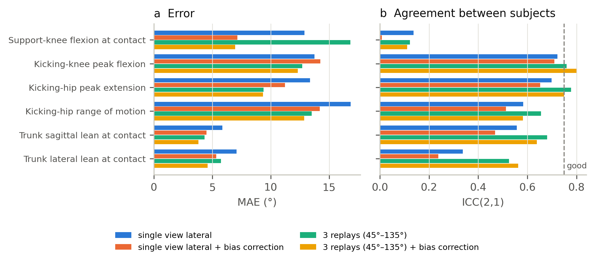{#fig:improve width=100%}

*Adapted lifter.* Fine-tuning the lifter reduced its 3D error on synthetic broadcast windows of unseen participants by 60–64 % (MPJPE from about 0.09 to 0.033–0.037 player heights). On the virtual camera at 80 px with held-out broadcast residuals the mean feature error fell from 14.7° to 8.3°, and agreement rose for every feature (for example kicking-knee peak flexion ICC 0.64 → 0.82, trunk lateral lean 0.37 → 0.77, support-knee flexion 0.08 → 0.51; Supplementary Figure {{figS:finetune}}a). On real video downscaled to 80 px the gain was smaller (mean error 15.0° → 13.3°; kicking-hip range of motion ICC 0.67 → 0.76, kicking-knee peak flexion 0.56 → 0.67), and support-knee flexion worsened (12.5° → 14.6°). On the CMU ball kicks, absent from training, the adapted lifter was worse than the official one (mean error 11.8° → 16.7°; kicking-hip range of motion 18.2° → 33.0°; Supplementary Figure {{figS:finetune}}b). Joint loads remained unreliable (ICC ≤ 0.41).

## 3.7 Fitness for use

No single-camera variable met the selected exploratory criteria in the typical simulated condition (Table {{tbl:accept}}). Three fused replays with laboratory correction met the between-participant ranking rule for kicking-knee flexion (ICC 0.80, 95% CI 0.70–0.87), while hip extension fell just short (0.749, 0.61–0.85); trunk leans met the laboratory-comparison rule. The adapted lifter met the ranking rule for knee flexion and trunk lateral lean in simulation, and hip range of motion on real video (ICC 0.76, 0.68–0.83). With the official lifter, only trunk lateral lean met a real-video comparison criterion (MAE 3.8°). No variable met the monitoring proxy (random differences 2.7–16.5 times 0.2 reference SD), and no joint moment met any criterion. These operational screens do not establish longitudinal repeatability or clinical, scouting or sporting validity.

: Exploratory operational criteria informed by the literature (MoVi; 80 px, 25 fps, known contact). Each cell gives the uses met and, in brackets, MAE (° or N·m/kg) and ICC(2,1); "—": no use met. *Norms*: comparison with laboratory norms (angles: MAE ≤ 5° and bias equivalent to zero within ±5°, TOST); *ranking*: between-participant ranking screen (ICC ≥ 0.75 with lower 95 % limit ≥ 0.5). No variable met the monitoring proxy (random error ≤ 0.2 between-player SD) in any condition. The first three columns are simulated (virtual camera, broadcast residuals, replay views; the adapted lifter with held-out residuals); 95 % confidence intervals are in Supplementary file 2. {#tbl:accept}

| Variable | Single camera | 3 replays + correction | Single camera, adapted lifter | Real video | Real video, adapted lifter |
|:-----------------|:--------------|:--------------|:--------------|:--------------|:--------------|
<!-- TABLA:accept -->

## 3.8 Field example

From the lateral and diagonal-behind views (Figure {{fig:field}}), strong kicks were told apart from soft ones by peak kicking-ankle speed (mean 12.0 m/s, range 8.9–14.7, versus 8.7 m/s, 8.0–10.4), kicking-knee peak flexion (93° versus 72°) and kicking-hip range of motion (113° versus 85°), and the ankle speeds were similar to those of the laboratory ball kicks (10.2–13.1 m/s). From the front the ordering was lost (6.7 m/s for the strong kick versus 8.1 m/s for the soft one) and kicking-hip peak extension became implausible (−32° and −25°), as the simulation predicted for frontal views (Supplementary Figure {{figS:fieldviews}}). Downscaling the player to 80 px changed knee peak flexion, hip extension and trunk leans by 1.4–3.4° on average and ankle speed by 1.1 m/s, but biased support-knee flexion (+7.6° on average, up to 24°). The estimated swing-leg moments, in contrast, were implausible: peak hip-flexor moments of 2.0–5.4 N·m/kg, well above the 1.0–2.0 N·m/kg of the laboratory ball kicks, and a soft kick could carry the same estimated load as a strong one (3.5 versus 3.6 N·m/kg; Supplementary Figure {{figS:fieldcompare}}).

![Field example: the author's kicks filmed with a smartphone (1080p, 60 fps; player about 200 px tall). (a) A strong kick from the lateral view at four instants, with the 2D skeleton detected by RTMW-x; thigh and shank of the kicking leg are coloured by the net hip and knee moment estimated by inverse dynamics, relative to the largest value in the player's strong kicks — an illustration of where and when the load concentrates, not a validated injury risk, because video-based moments are inflated (Section 3.5). (b) Kicking-knee and kicking-hip flexion and kicking-ankle speed around contact for the strong (red, n = 3) and soft (blue, n = 2) lateral kicks; thin lines: individual kicks; thick lines: mean.](../../resultados/paper/fig11_field.png){#fig:field width=100%}

# 4. Discussion

## 4.1 What broadcast video can measure today

In these laboratory participants, no single-camera variable met the selected exploratory criteria; leg-angle errors were 15–20° and the best between-participant agreement was moderate. Small absolute error alone does not ensure ranking: trunk leans varied little between participants. The tested 25-versus-50-fps contrast had less observed effect than camera view, detector error and contact timing. Replay fusion with laboratory correction allowed some variables to meet ranking or laboratory-comparison screens in this benchmark. The monitoring proxy was not met; longitudinal monitoring after injury was not directly tested. Gaussian noise exaggerated error relative to real residual sequences by up to 1.8 times, supporting residual-based simulations and checks on real images. The single-author field example was illustrative and had no reference measurement.

## 4.2 The connected ball and football-specific data

Known reference contact reduced leg-feature error by about a quarter. LaLiga describes contact timing as an output of its connected-ball system [@laliga2026], which motivates testing synchronised sensor timing with pose reconstruction. We did not evaluate sensor timing error, video synchronisation or availability to analysts. In five usable CMU trials, the ankle-speed proxy preceded extrapolated contact by about 20 ms and changed tested features by up to 2.1°; this cannot validate a sensor-assisted match pipeline. A correction learnt on air kicks and a lifter adapted to air kicks worsened the CMU ball-kick results. Football-specific kicks with run-up and impact, broadcast images and synchronised 3D are needed to train and externally validate models and corrections.

## 4.3 Joint moments and injury-risk interpretation

The laboratory association between KLI and ankle speed is a within-model consistency observation: both use the same kinematic input. The simplified model is not an independent measure of muscle, tendon or tissue loading. Video agreement was poor (KLI ICC 0.090), and b = 0.081 is a calibration slope, not scale-invariant reliability. No repeatability across sessions or injury prediction was tested. The illustrative q scenarios therefore cannot determine the size or duration of a prospective study of this KLI. Football-specific reference data, a justified clinical error model and prospective outcomes would be required.

## 4.4 Practical implications

Within these benchmark conditions, current single-camera estimates do not support individual clinical, scouting or load-based decisions. Replay fusion, known contact and external reference comparisons are candidates for further validation; passing an exploratory participant-level rule is not demonstrated practical validity. Vendor metrics should report error and agreement against a suitable reference under the intended conditions.

## 4.5 Limitations

The reference is laboratory-based: only seven kicks (two participants) are football kicks with a ball, and the 83 MoVi kicks are air kicks by non-footballers, slower than match shots; lifter errors were larger for ball kicks (15.0° versus 9.2° without noise), so our errors are probably optimistic for match shots. The 2D error comes from 200 shots of one competition, with annotations that include their own error, and is extrapolated above about 90 px. The virtual camera reproduces geometry, size, frame rate and detector error, but not motion blur, occlusion or camera motion, and the digital twin checks this only on laboratory images. Scale and the vertical were given; in practice both add error. The load model is simplified and identical for reference and estimate, so it quantifies measurability rather than tissue loading. The acceptability criteria come from the literature but were applied after the main results were known, the study was not pre-registered, and the event-count sensitivity is hypothetical, without a validated clinical error model or measured injury incidence. The field example involves one recreational player and no reference, and its player size (about 200 px) is closer to a broadcast close-up than to a wide shot. We evaluated one detector and one lifter, which is why the benchmark is released.

## 4.6 Conclusions

In this benchmark, no single-camera variable met the selected exploratory criteria in the typical simulated condition. Replay fusion and adaptation improved some variables, but results depend on reference-derived scale and alignment and known contact and kicking leg. Passing an exploratory screen does not establish clinical or sporting fitness for use. Current evidence does not support longitudinal monitoring, individual clinical or scouting decisions, or injury-risk prediction. The laboratory KLI association is model consistency and its video agreement remains poor. Further football-specific external validation is needed.

# Acknowledgements

The CMU data used in this project was obtained from mocap.cs.cmu.edu; the database was created with funding from NSF EIA-0196217. The author thanks the BioMotion Lab (MoVi), the authors of 3DSP/AutoSoccerPose and SoccerNet, OpenMMLab (RTMW, YOLOX) and the authors of MotionAGFormer for releasing their data and models.

# Author contributions (CRediT)

Roberto Martín Gutiérrez: Conceptualization, Investigation (field recordings), Supervision (direction of the AI-assisted work and choice among the options proposed during it), Writing – review & editing. Methodology, Software, Formal analysis, Visualization and Writing – original draft were carried out with generative AI under the author's direction (see Declaration of generative AI use).

# Funding

No funding was obtained for this work.

# Disclosure of interest

The author reports there are no competing interests to declare. The author is employed as a research engineer in AI and computational cardiology at ICICOR – Hospital Clínico Universitario de Valladolid; this study was carried out independently, and the employer had no role in it.

# Declaration of generative AI use

Generative AI (Claude, Anthropic, used through Claude Code) was used extensively. Under the author's direction it proposed the study design and the analyses, searched and checked the literature, wrote and ran the analysis code and its unit tests, produced the figures, and drafted, edited and translated the manuscript. The author conceived the project and its football focus, chose among the options proposed, recorded the field example, reviewed the figures and the manuscript and requested changes, and takes full responsibility for the content. All code, intermediate outputs and statistical results are public so that every number can be checked independently.

# Data availability statement

The datasets analysed are available from their owners: the CMU Graphics Lab Motion Capture Database (mocap.cs.cmu.edu), MoVi (non-commercial research licence; [@ghorbani2021]) and 3D Shot Posture [@yeung2024]. Aggregated results, all figures and the broadcast residual bank (numerical 2D residuals, no images) are available at {{REPO_URL}} and archived in Zenodo ([10.5281/zenodo.23439408](https://doi.org/10.5281/zenodo.23439408)). Per-participant results derived from MoVi cannot be redistributed under its licence but are regenerated by the released code. The field-example videos show the author and are available from him on request; the per-kick results are in the repository.

# Code availability statement

All code (Python) for the simulation, reconstruction, statistics and figures, with unit tests, is available at {{REPO_URL}} under the MIT licence and archived at Zenodo ([10.5281/zenodo.23439408](https://doi.org/10.5281/zenodo.23439408), version v1.0.0). The complete statistical outputs are provided as a supplementary file.

# Data deposition

The broadcast residual bank and the aggregated results are deposited in Zenodo ([10.5281/zenodo.23439408](https://doi.org/10.5281/zenodo.23439408)).

# Ethics approval and informed consent

This secondary analysis used only public, de-identified datasets collected by their owners with ethical approval and participants' informed consent; no new data were collected for the main analyses, so no further approval was required. The only person in the field example is the author, who consents to the publication of his images.

# References

::: {#refs}
:::

# Supplementary material

Supplementary file 1: GRRAS checklist. Supplementary file 2: complete statistical outputs (CSV and JSON). Supplementary figures follow.

<!-- SUPLEMENTO -->

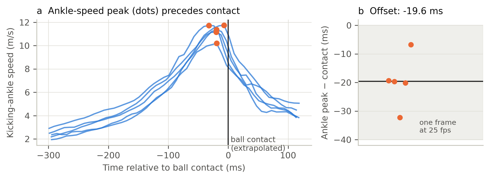{#figS:contact width=100%}

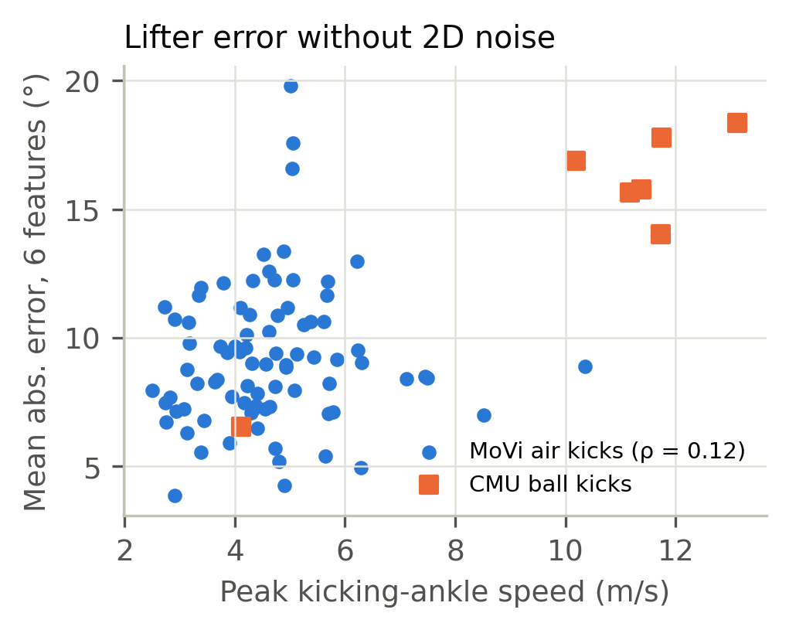{#figS:intensity width=60%}

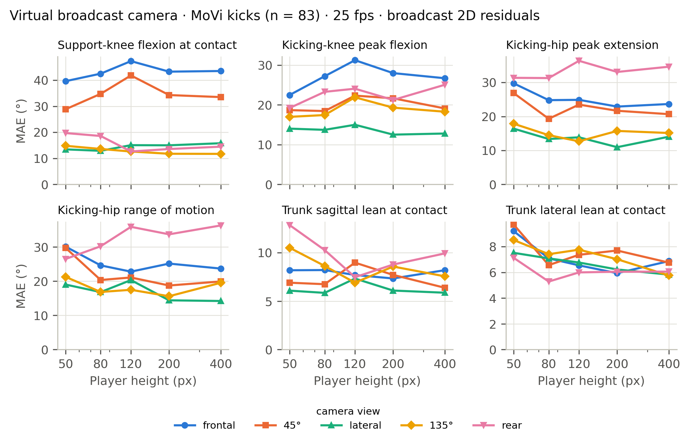{#figS:sens width=100%}

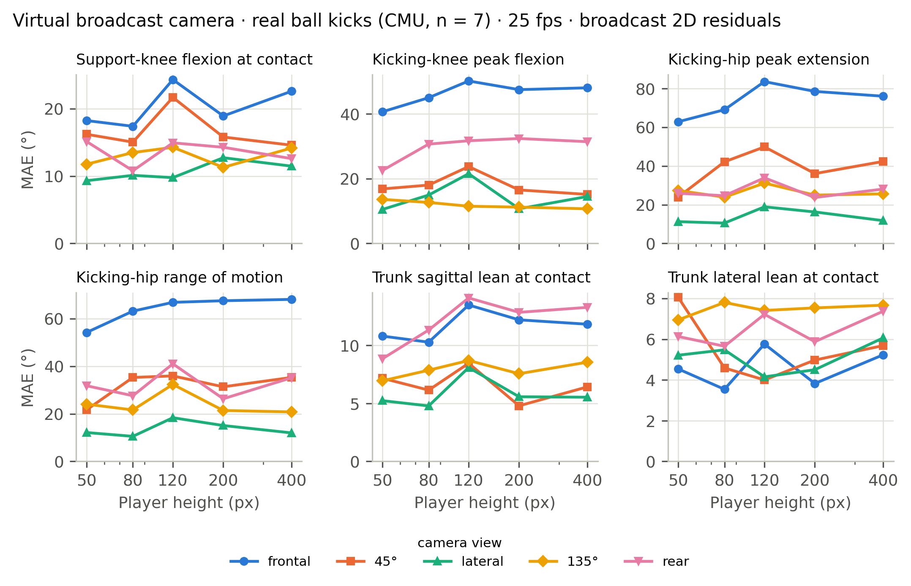{#figS:senscmu width=100%}

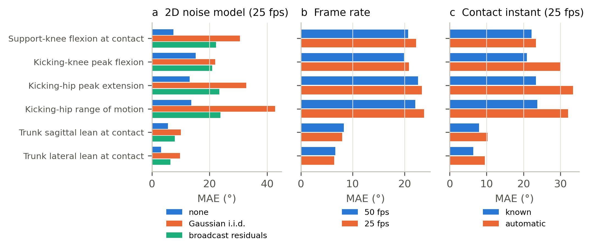{#figS:ablation width=100%}

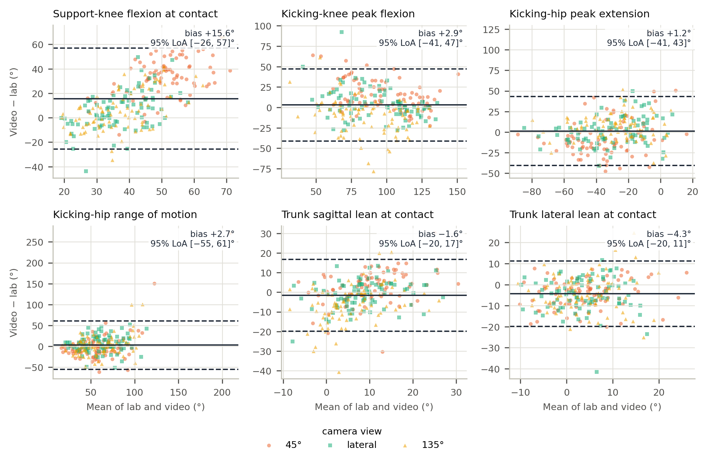{#figS:bland width=100%}

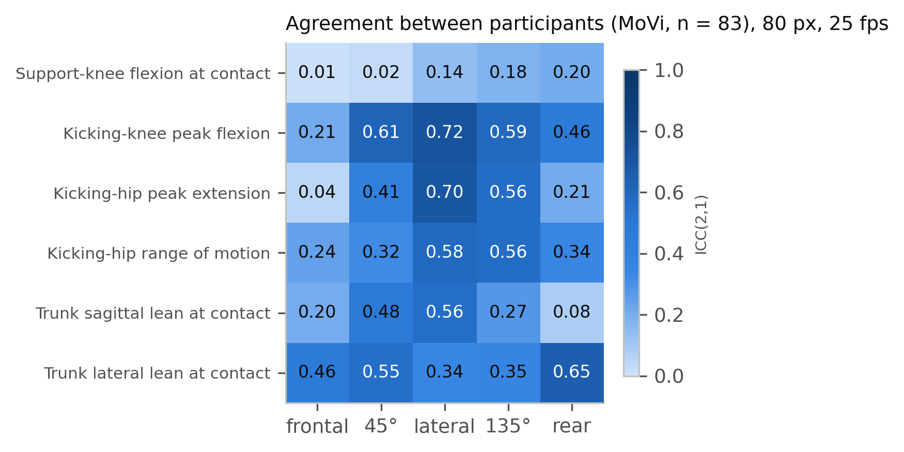{#figS:icc width=80%}

{#figS:finetune width=100%}

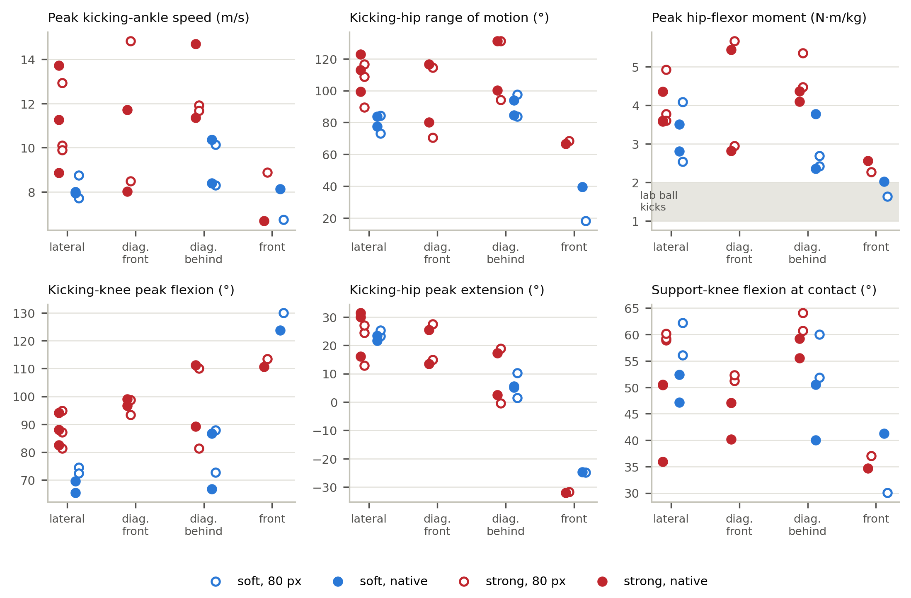{#figS:fieldviews width=100%}

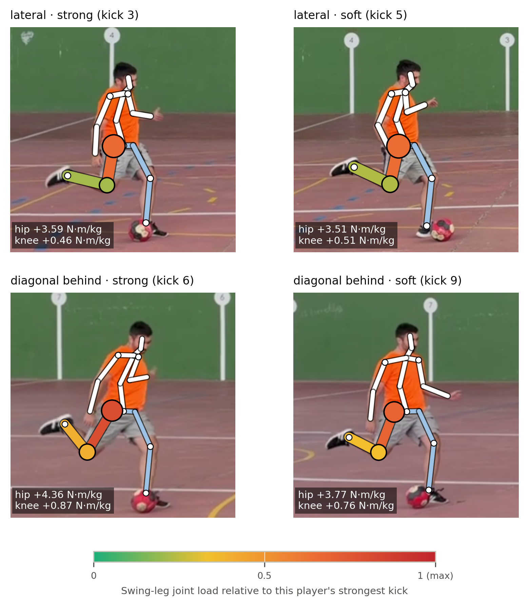{#figS:fieldcompare width=80%}
