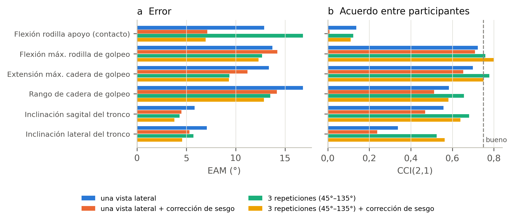
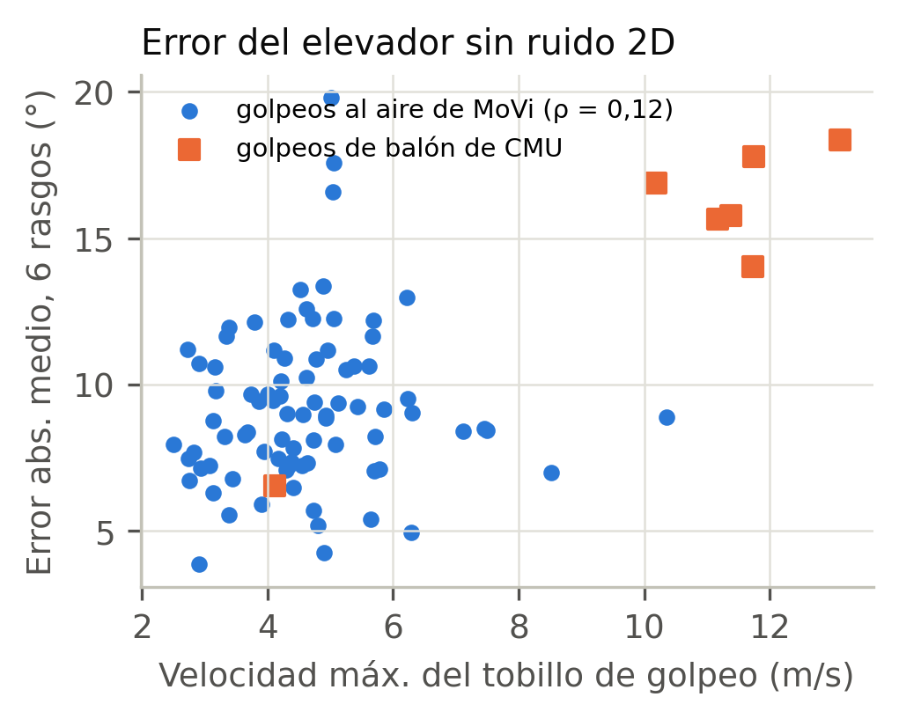
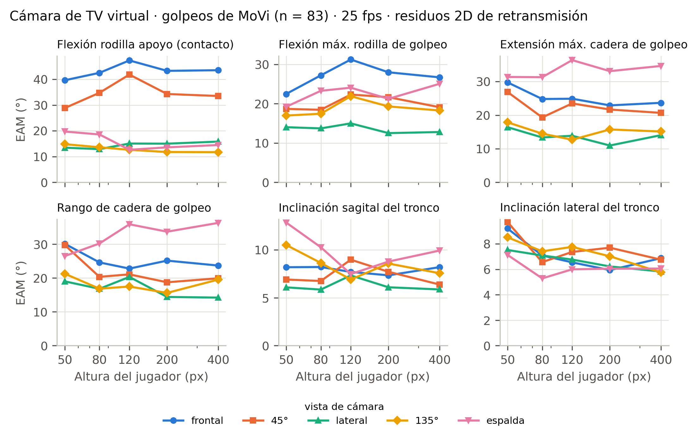
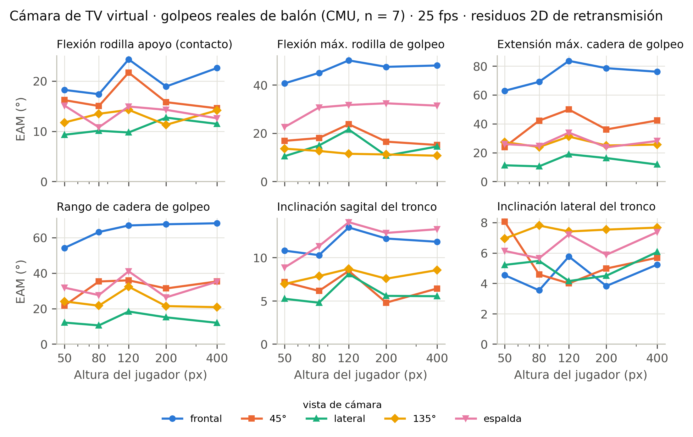
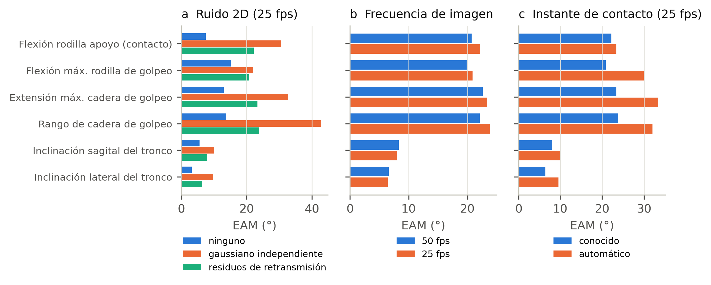
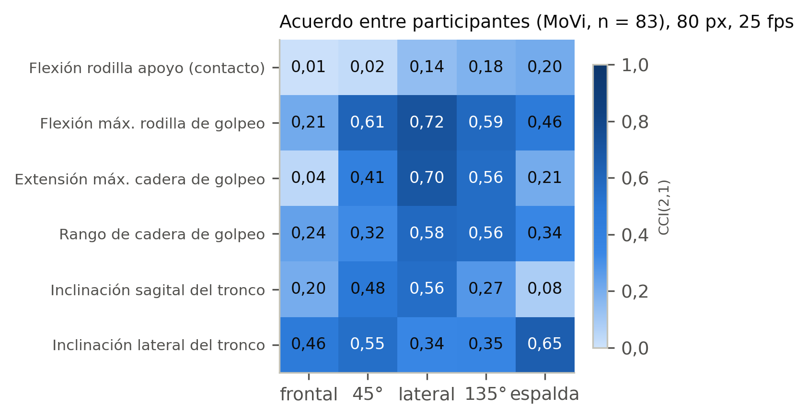
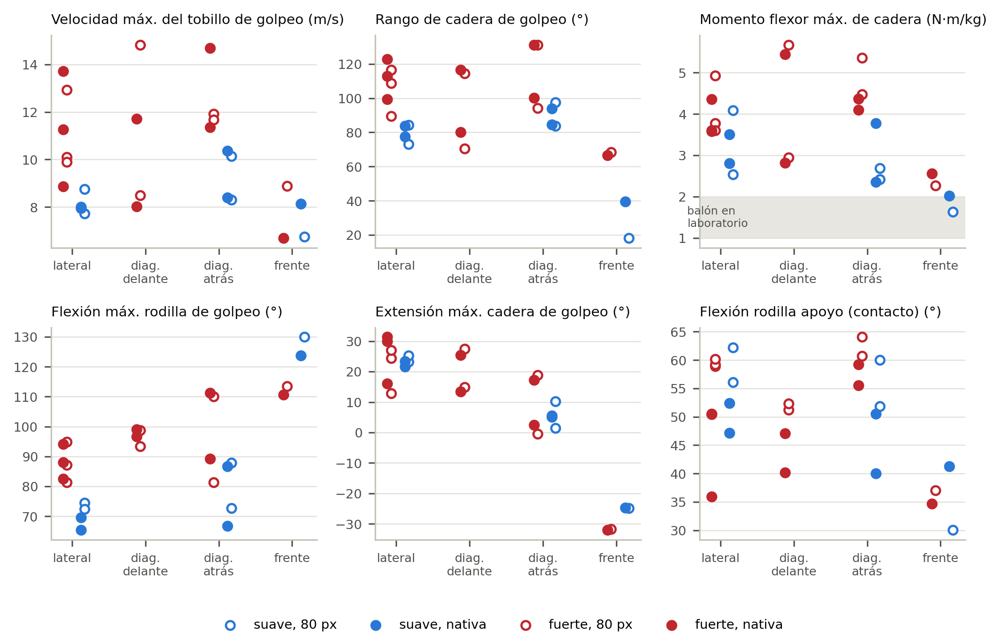
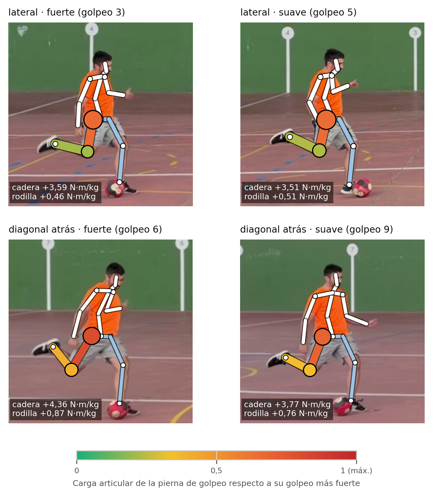

**Versión de lectura mantenida en el repositorio.** El preprint publicado en SportRxiv el 26 de octubre de 2026 ([DOI 10.51224/SportRxiv.1131](https://doi.org/10.51224/SportRxiv.1131)) es la versión de referencia y no está revisado por pares. Esta fuente incorpora sus correcciones científicas; no es una copia idéntica del PDF publicado. Véase [estado de versiones](../PUBLICATION_VERSION.md).

**Autor.** Roberto Martín Gutiérrez^1^ (autor de correspondencia). ^1^ Investigador independiente, España. ORCID: [0009-0004-5724-3502](https://orcid.org/0009-0004-5724-3502). Correo: convderover@gmail.com. LinkedIn: roberto-martín-gutiérrez-ingeniería-biomédica.

**Tipo de artículo:** investigación original. **Título abreviado:** Biomecánica del golpeo desde la retransmisión. **Palabras del texto principal:** {{WORDS}}.

*Versión en español del manuscrito original en inglés.*

# Resumen

Este estudio comparó estimaciones del golpeo desde una cámara de tipo retransmisión con captura óptica: siete golpeos de balón de dos personas de CMU y 83 golpeos al aire de MoVi. El error del detector se obtuvo de 200 disparos de la Premier League; la validación con vídeo real incluyó 162 grabaciones de 82 participantes. Se evaluaron seis rasgos cinemáticos y tres momentos articulares de un modelo simplificado mediante error, acuerdo y criterios operativos exploratorios. El error 2D fue del 7,6–12,9% de la altura. En la condición simulada típica (80 px, 25 fps, contacto conocido y vistas de repetición), ninguna variable de una sola cámara cumplió los criterios seleccionados (mejor CCI 0,64). El gemelo digital predijo errores agregados del vídeo real (r = 0,84). Tres repeticiones simuladas con corrección de laboratorio cumplieron el criterio de ordenación para flexión de rodilla (CCI 0,80) y el de comparación con laboratorio para inclinaciones de tronco. El KLI se correlacionó con velocidad de tobillo en laboratorio (ρ = 0,79), una comprobación de consistencia con entrada compartida; su acuerdo desde vídeo fue pobre (CCI 0,090). La adaptación mejoró golpeos al aire no vistos y empeoró los golpeos de balón de CMU. Trece grabaciones con móvil aportaron un ejemplo ilustrativo sin referencia. Estos resultados apoyan la evaluación prudente y una validación externa específica de fútbol; no avalan decisiones clínicas, de selección ni de riesgo de lesión individuales.

**Palabras clave:** fútbol; golpeo; vídeo de retransmisión; captura de movimiento sin marcadores; acuerdo; dinámica inversa

# 1. Introducción

El golpeo define el fútbol y también es un mecanismo de lesión. Las lesiones musculares suponen casi un tercio de las lesiones con baja en el fútbol profesional masculino, con un peso destacado de aductores (23 %) y cuádriceps (19 %) [@ekstrand2011], y las de cadera e ingle representan el 12–16 % de todas las lesiones de cada temporada [@werner2009; @werner2019]. El golpeo es una de las dos acciones principales de las lesiones agudas del aductor largo [@serner2019] y un mecanismo principal de las roturas del recto femoral [@mendiguchia2013]. Su biomecánica — el armado que estira los flexores de cadera, la extensión rápida de la rodilla y el frenado de la pierna antes del impacto — está bien descrita en laboratorio [@lees2010; @kellis2007; @nunome2002; @dorge2002; @apriantono2006; @shan2005; @charnock2009].

En los partidos, sin embargo, el golpeo solo se observa en el vídeo de la retransmisión. Desde agosto de 2026 LaLiga EA Sports instrumenta cada balón de partido con un sensor que registra el instante de cada toque [@laliga2026]: el balón se mide, el cuerpo que lo golpea no. La estimación monocular de la postura ya extrae la postura del golpeo con una sola cámara: AutoSoccerPose construye secuencias 2D y 3D de la postura del disparo a partir de retransmisiones [@yeung2024], Noworolnik y Jaworek-Korjakowska puntúan la técnica de tiro con rasgos de una vista lateral [@noworolnik2025], y la postura 3D de los jugadores desde la retransmisión es un tema activo [@jiang2024worldpose; @khan2026; @baumgartner2023].

Lo que falta es el error de medida de las propias variables del golpeo en condiciones de retransmisión. Los sistemas sin marcadores se han validado con varias cámaras de laboratorio [@kanko2021; @needham2021; @uhlrich2023] y en el golpeo frente a digitalización manual [@palucci2022], pero una cámara de retransmisión es distinta: el jugador que dispara ocupa a menudo 30–90 píxeles, el ángulo es arbitrario, la frecuencia es de 25 o 50 fps y las imágenes van comprimidas. En gestos atléticos, los ángulos monoculares pueden correlacionar con la captura óptica y las velocidades angulares no [@yeung2025]; las cargas articulares, que necesitan segundas derivadas de la posición, deberían ser aún más frágiles, y son lo que querría un servicio médico para un índice de «sufrimiento articular» o de riesgo de lesión. Sin un error de medida conocido, las métricas de técnica o de carga obtenidas de la retransmisión no se pueden interpretar, y los modelos de lesiones construidos sobre ellas no se pueden validar.

Nuestra pregunta de investigación fue: ¿para qué usos prácticos — comparar con normas de laboratorio, ordenar jugadores o seguir a un jugador — son aceptables la cinemática del golpeo y las cargas articulares de la pierna de golpeo estimadas con vídeo de tipo retransmisión de una sola cámara, y qué tamaño tendría que tener un estudio que validara como predictor de lesiones un índice de carga obtenido de la retransmisión? Además cuantificamos el error 2D real del detector en disparos de retransmisión, comprobamos la simulación con vídeo real y evaluamos tres remedios.

# 2. Métodos

## 2.1 Diseño, datos y comunicación

Es un estudio de comparación de métodos (acuerdo) con análisis secundario de conjuntos de datos públicos, completado con un ejemplo de campo (apartado 2.6), con la captura óptica como referencia (Figura {{fig:design}}, Tabla {{tbl:data}}). Una cámara de retransmisión virtual filmó cada golpeo de laboratorio con tamaños de jugador, vistas y frecuencias controlados; sus proyecciones 2D exactas se contaminaron con el error que comete un detector en disparos reales de retransmisión, y un elevador temporal reconstruyó el 3D, del que se recalcularon los rasgos y las cargas. La misma cadena se aplicó a vídeo real con captura sincronizada, y cada grabación real se reprodujo con su gemelo digital. La comunicación sigue las pautas GRRAS para estudios de fiabilidad y acuerdo [@kottner2011] (lista de comprobación en el material suplementario). El estudio no se registró previamente.

![Figura original en inglés del preprint publicado. Diseño del estudio. (1) Los golpeos de laboratorio registrados con captura óptica aportan la referencia (se muestra un golpeo de balón de CMU, con las posturas difuminadas hasta el contacto). (2) Una cámara de retransmisión virtual filma cada golpeo desde cinco vistas, con cinco tamaños de jugador y a 25 o 50 fps (miniaturas: el mismo instante a 200, 80 y 50 px), y sus proyecciones 2D exactas se contaminan con los residuos que comete un detector en disparos reales de retransmisión; el vídeo real con captura sincronizada (MoVi) y un gemelo digital de cada grabación ponen a prueba la simulación. (3) Los puntos 2D se elevan a 3D con MotionAGFormer, con los pesos oficiales o con los adaptados al golpeo. (4) Seis rasgos cinemáticos y tres momentos de la pierna de golpeo se comparan con el laboratorio (sesgo, error absoluto medio, límites de acuerdo y CCI con las clases de Koo y Li), y se ilustran recuentos hipotéticos de eventos bajo supuestos independientes de fracción de información q.](../../resultados/paper_es/fig1_design.png){#fig:design width=100%}

**CMU (golpeos de balón).** Siete ensayos etiquetados «soccer – kick ball» de la base de datos de captura de movimiento de CMU [@cmu] (sujeto 10, ensayos 01–06; sujeto 11, ensayo 01; Vicon, 120 Hz), con los centros articulares virtuales del programa de captura. Seis ensayos tienen tres marcadores en el balón; el 11_01 incluye carrera previa; el 10_04 es un golpeo lento (velocidad máxima del tobillo de 4,1 m/s frente a 10,2–13,1 m/s).

**MoVi (varios participantes, con vídeo).** La ronda F de MoVi [@ghorbani2021] contiene, para 90 participantes, una acción de golpeo capturada a 120 Hz y procesada con Visual3D, con vídeo sincronizado de dos cámaras fijas calibradas (800 × 600 px, 30 fps), altura y masa corporal. Las articulaciones guardadas como (0, 0, 0) se trataron como huecos; los de hasta 0,25 s se interpolaron y se excluyeron los golpeos con huecos más largos, con lo que quedaron 83 participantes (55 mujeres). Son golpeos al aire de personas que no juegan al fútbol, así que sirven para validar la cadena de medida, no para describir la técnica futbolística. La sincronía (fotograma de captura = 4 × fotograma de vídeo) se comprobó proyectando la captura sobre las detecciones (desfase de 0 ± 2 fotogramas de captura).

: Conjuntos de datos usados. {#tbl:data}

| Conjunto | Papel | Tamaño | Frecuencia | Notas |
|:--------|:--------------|:----------------|:-------|:----------------|
| CMU | Referencia: golpeos reales de balón | 2 participantes, 7 golpeos | 120 Hz | Vicon; marcadores en el balón en 6 golpeos; uno con carrera previa |
| MoVi (ronda F) | Referencia y vídeo real | 83 participantes, 83 golpeos al aire, 2 cámaras | 120 Hz; vídeo a 30 fps | Visual3D; altura y masa; licencia no comercial |
| 3DSP | Error 2D del detector en retransmisión | 200 disparos de la Premier League, 6.000 detecciones | 25 fps | Anotación manual 2D del jugador que dispara |

## 2.2 Rasgos cinemáticos y cargas articulares de la pierna de golpeo

La pierna de golpeo es aquella cuyo tobillo alcanza la mayor velocidad máxima, y el contacto se aproxima por el pico de velocidad del tobillo de golpeo; en los ensayos de CMU con marcadores en el balón lo comparamos con el contacto real, obtenido extrapolando hacia atrás la recta de salida del balón hasta su posición de reposo. Los seis rasgos se calcularon con un esqueleto de ocho articulaciones (hombros, caderas, rodillas y tobillos; Figura {{fig:model}}a–d): flexión de la rodilla de apoyo en el contacto; flexión máxima de la rodilla de golpeo y extensión máxima de la cadera de golpeo (de −0,3 s al contacto); rango de movimiento de la cadera de golpeo (de −0,3 a +0,2 s); e inclinaciones sagital y lateral del tronco en el contacto. Coinciden en parte con los de sistemas previos de una cámara [@noworolnik2025] y con determinantes del rendimiento del golpeo [@lees2010; @kellis2007].

Entre el final del armado y el contacto, la pierna de golpeo no toca el suelo, así que los momentos netos en su rodilla y su cadera quedan determinados por la cinemática y la inercia del muslo, la pierna y el pie (Figura {{fig:model}}e). Usamos un modelo de Newton–Euler con los parámetros de los segmentos de de Leva [-@deleva1996], el pie como masa puntual en el tobillo (los esqueletos de retransmisión no tienen puntos del pie) y la velocidad angular de cada segmento a partir de su eje longitudinal (ω = u × u̇). Los momentos se proyectaron sobre el eje lateral de la pelvis (positivos: extensor de rodilla y flexor de cadera) tras un filtrado Butterworth de fase cero (12 Hz, o 0,35 × fps si es menor). Se extrajeron tres picos normalizados por la masa: los momentos flexor máximo de cadera y extensor máximo de rodilla desde el final del armado hasta el contacto, y el momento flexor máximo (de frenado) de rodilla en los 100 ms previos al contacto; el Índice de Carga del Golpeo (KLI) es su media en puntuaciones z respecto a la distribución de laboratorio de MoVi. El modelo se verificó analíticamente (miembro estático, simetría especular, escalado cuadrático con la velocidad) y fue idéntico para la referencia y la estimación, de modo que la comparación aísla la cadena de medida. En un golpeo fuerte y uno lento del mismo jugador da 1,01 frente a 0,43 N·m/kg de momento flexor de cadera y 0,89 frente a 0,12 N·m/kg de momento flexor de rodilla (Figura {{fig:model}}f).

![El modelo del golpeo sobre un golpeo real de balón (CMU 10_01, 120 Hz). (a–d) Cinco de los seis rasgos cinemáticos leídos sobre el esqueleto (el sexto es el rango de movimiento de la cadera de golpeo): extensión de la cadera de golpeo al final del armado (a), flexión máxima de la rodilla de golpeo (b), flexión de la rodilla de apoyo e inclinación sagital del tronco en el contacto con el balón (c) e inclinación lateral del tronco en el contacto (d); naranja: pierna de golpeo; verde: pierna de apoyo. (e) Diagrama de cuerpo libre de la pierna de golpeo 50 ms antes del contacto: pesos de los segmentos en sus centros de masas, fuerza de reacción en la cadera y momentos articulares netos. (f) Momentos netos de cadera y rodilla de este golpeo y de un golpeo lento del mismo jugador (10_04, discontinua); franja gris: del final del armado al contacto; franja naranja: últimos 100 ms; puntos: los tres picos de carga usados como variables.](../../resultados/paper_es/fig2_model.png){#fig:model width=100%}

## 2.3 Error 2D en retransmisión, cámara virtual y elevación a 3D

Usamos el conjunto 3D Shot Posture (3DSP) [@yeung2024]: 200 disparos de retransmisiones de la Premier League inglesa (vía SoccerNet [@deliege2021]), con 20 fotogramas consecutivos a 25 fps y 17 puntos anotados a mano del jugador que dispara. RTMW-x [@jiang2024rtmw; @jiang2023rtmpose] se aplicó dentro de la caja anotada de la persona, y también al 75 % y al 50 % de escala en una cuarta parte de los disparos (6.000 detecciones). Damos el error RMS por eje en función de la altura del jugador *H* y ajustamos σ(*H*) = √((*aH*)² + *b*²), una cota superior del error del detector porque las anotaciones tienen su propio error.

Cada golpeo de referencia se remuestreó a 25 o 50 fps y se filmó con una cámara estenopeica a 40 m, a 15° de elevación y con azimuts de 0° (frontal), 45°, 90° (lateral, del lado de la pierna de golpeo), 135° y 180°, con *H* ∈ {400, 200, 120, 80, 50} px. Se añadieron tres modelos de error 2D: ninguno; ruido gaussiano independiente con la σ(*H*) medida; y un remuestreo de secuencias completas de 20 fotogramas de residuos reales de RTMW en 3DSP, escalados por *H*, que conserva la correlación temporal y los fallos groseros, como confundir izquierda y derecha.

Elevamos el 2D a 3D con MotionAGFormer-B y sus pesos oficiales de Human3.6M [@mehraban2024; @ionescu2014]. Dos detalles tuvieron efectos de primer orden: la entrada 2D debe normalizarse en un recorte centrado en el jugador, porque normalizarla en toda la imagen, como hace la demostración pública, da errores de 50–90° con jugadores pequeños incluso sin ruido; y las puntuaciones de RTMW no son probabilidades, así que se sustituyeron por una confianza constante de 0,9 (pasarlas sin cambios infravaloraba la flexión de la rodilla de golpeo en 41°). La escala se obtuvo de la longitud del muslo de referencia y se realizó un alineamiento rígido por secuencia contra la referencia. Son condiciones optimistas asistidas por referencia, no una calibración de campo demostrada desde partidos. La pierna de golpeo se proporcionó desde la referencia. El contacto conocido usó el evento de laboratorio; el automático, el pico de velocidad del tobillo reconstruido. No se validó calibración autónoma, identificación de pierna ni sincronización de un sensor en partidos.

## 2.4 Vídeo real y gemelo digital

**Vídeo real utilizable:** 162 grabaciones de 82 participantes; dos participantes solo aportaron una cámara utilizable.

Para cada participante de MoVi y cada cámara, YOLOX-m [@ge2021yolox] detectó a la persona; las imágenes se redujeron para que midiera 120, 80 o 50 px y se comprimieron en JPEG, o se dejaron a resolución nativa (unos 330 px), y RTMW-x estimó la postura. En el gemelo digital, cada grabación se volvió a simular exactamente en su geometría calibrada y con sus mismos fotogramas, con tres modelos de error 2D: ninguno, residuos reales de RTMW de los *demás* participantes de MoVi y residuos de retransmisión. Comparar errores simulados y reales contrasta el simulador en el dominio de laboratorio de MoVi; la transferencia a imágenes de partido no está validada.

## 2.5 Remedios

*Fusión de repeticiones.* Promediamos las estimaciones de dos (45° y 135°) o tres (45°, 90° y 135°) repeticiones virtuales con errores 2D independientes. *Corrección de sesgo.* Una calibración lineal por vista (referencia ≈ *a* + *b*·estimación) se aprendió en golpeos de laboratorio y se aplicó a participantes no vistos (dejando uno fuera) y, para probar la transferencia, se aprendió con todos los golpeos de MoVi y se aplicó a los golpeos de balón de CMU. *Elevador adaptado al golpeo y a la retransmisión.* MotionAGFormer-B se ajustó con datos sintéticos de retransmisión generados a partir de la captura de MoVi (las 21 acciones grabadas; vista aleatoria, elevación de 5–25°, distancia de 15–60 m, *H* de 40–400 px, 25 o 50 fps; residuos de retransmisión, ruido gaussiano o proyección exacta) durante 1.000 iteraciones con la pérdida original. Los participantes se repartieron en dos pliegues y cada modelo se evaluó solo con los participantes que nunca vio. Los disparos de 3DSP se dividieron en dos mitades estratificadas por altura del jugador: el entrenamiento usó una mitad y todas las pruebas con cámara virtual del elevador adaptado, la otra. Los golpeos de balón de CMU no se usaron nunca para entrenar.

## 2.6 Ejemplo de campo

Para ilustrar la cadena con golpeos reales de fútbol, el autor (varón adulto, 177 cm, 78 kg, jugador aficionado, diestro) realizó 13 golpeos con el empeine a balón parado en una pista exterior (8 fuertes y 5 suaves), cada uno filmado una vez con un móvil en una posición fija (1920 × 1080 px, 60 fps) desde una de cuatro tomas: lateral (5 golpeos), diagonal desde atrás (4), diagonal desde delante (2) y de frente (2). El jugador midió 170–241 px (mediana de 199 px). Los vídeos se procesaron con el mismo detector y el mismo elevador a resolución nativa y con el jugador reducido a 80 px y comprimido en JPEG. La reconstrucción se escaló con una longitud de muslo de 0,245 × estatura [@winter2009], la vertical de la imagen se tomó como la vertical del mundo (cámara nivelada), los cruces ocasionales de las etiquetas izquierda y derecha de rodillas y tobillos se corrigieron por continuidad temporal (Viterbi; 20 de 10.200 fotogramas) y el contacto fue el pico de velocidad del tobillo derecho (de golpeo). Sin captura óptica, este ejemplo pone a prueba la verosimilitud — si se distinguen los golpeos fuertes de los suaves — y la consistencia entre resoluciones, no la validez.

## 2.7 Estadística y criterios de aceptabilidad

Para cada variable damos el sesgo, el error absoluto medio (EAM), los límites de acuerdo del 95 % [@bland1986], el CCI(2,1) de acuerdo absoluto [@shrout1979] con las clases de Koo y Li [@koo2016] y la pendiente de calibración b (regresión de la referencia sobre la estimación), con intervalos de confianza del 95 % de 1.000 remuestreos por participantes. La *condición típica de retransmisión* es *H* = 80 px, 25 fps, residuos de retransmisión, contacto conocido y vistas de repetición (45–135°). El tamaño muestral lo fijaron los datos disponibles, sin cálculo prospectivo de precisión. Los análisis principales incluyen 249 pares participante-vista de 83 personas, no 249 personas independientes. El bootstrap conserva todas las vistas del participante remuestreado. Los límites de acuerdo agrupados describen esa mezcla y no la repetibilidad individual entre sesiones. La pendiente de calibración depende de la escala y no estima fiabilidad.

Se aplicaron criterios operativos exploratorios después de conocer los resultados; no son umbrales de decisión clínica ni deportiva validados. *Comparación con laboratorio* (ángulos): EAM ≤ 5° y sesgo medio equivalente a cero dentro de ±5° (TOST, α = 0,05, una diferencia media por participante [@schuirmann1987; @lakens2017]). El margen procede de literatura de marcha [@mcginley2009], no de un umbral universal para fútbol. *Ordenación entre participantes*: CCI ≥ 0,75 y límite inferior del IC 95% ≥ 0,5 [@koo2016]. *Aproximación al seguimiento*: DE de diferencias entre métodos ≤ 0,2 DE entre participantes [@hopkins2009]. Este filtro no valida el seguimiento longitudinal: harían falta sesiones repetidas y un cambio relevante específico del fútbol.

Las curvas de laboratorio y reconstruidas se compararon mediante un procedimiento propio de permutación de signos emparejados, inspirado en inferencia funcional [@pataky2012; @pataky2015; @nichols2002]. Para cada una de cuatro comparaciones, 10.000 permutaciones por participante dieron el umbral de máximo |t| para la familia temporal (α = 0,05); los valores p de racimos usaron su masa máxima. La corrección fue interna a cada curva, no conjunta entre las cuatro. No se utilizó el paquete spm1d.

## 2.8 Sensibilidad ilustrativa del número de eventos

El error de medida puede atenuar asociaciones exposición–resultado [@hutcheon2010]. Para un modelo univariable ilustrativo de riesgos proporcionales con exposición estandarizada, α = 0,05 y potencia del 80%, la aproximación de Schoenfeld [@schoenfeld1983] es *D* = (*z*~0,975~ + *z*~0,8~)² / (*q* · ln² HR), con fracción de información q justificada independientemente. Bajo error clásico aditivo no diferencial, q corresponde a fiabilidad y correlación exposición-sustituto al cuadrado. Para HR hipotético = 1,5, q = 1, 0,5, 0,2 y 0,1 da 48, 96, 239 y 478 eventos, redondeando al alza. No son tamaños muestrales del KLI ni predicciones de temporadas. La pendiente de calibración depende de escala y no puede sustituir a q sin establecer el modelo de error. No se midieron lesiones, efecto clínico ni incidencia.

# 3. Resultados

## 3.1 Instante del contacto y error del detector en retransmisión

En los cinco golpeos de CMU con marcadores en el balón, el pico de velocidad del tobillo de golpeo precedió al contacto real en 19,6 ms (6,8–32,2 ms; Figura suplementaria {{figS:contact}}), menos de un fotograma de retransmisión, y calcular los rasgos en ese pico los cambió como mucho 2,1°.

En los disparos de retransmisión, el error RMS por eje del detector siguió σ(*H*) = √((0,063 *H*)² + 3,9²) px, y bajó del 12,9 % de la altura del jugador a unos 27 px al 7,6 % a unos 86 px (Figura {{fig:2d}}a). Los tobillos (14,4 %) y las muñecas (13,7 %) fueron las articulaciones menos precisas, y las caderas (5,6 %) y los hombros (5,5 %) las más precisas (Figura {{fig:2d}}b). En vídeo de laboratorio reducido a los mismos tamaños, el mismo detector se equivocó en un 3,1–4,0 % de *H*: las imágenes de retransmisión son más del doble de difíciles.

{#fig:2d width=100%}

## 3.2 Sensibilidad a la vista, el tamaño, la frecuencia de imagen, el modelo de error y el contacto

Sin ruido 2D, el elevador por sí solo produjo un error medio de los rasgos de 9,2° en los golpeos de MoVi y de 15,0° en los golpeos de balón de CMU; dentro de MoVi, el error no se relacionó con la intensidad del golpeo (ρ de Spearman = 0,12; *p* = 0,27; Figura suplementaria {{figS:intensity}}). Con residuos de retransmisión, la vista de cámara fue lo que más influyó: los errores en MoVi fueron de 11,9° (lateral), 13,5° (135°), 19,0° (45°), 20,0° (espalda) y 22,6° (frontal) (Figuras suplementarias {{figS:sens}} y {{figS:senscmu}}). El tamaño del jugador influyó poco entre 50 y 400 px (16,8–18,2°). El ruido gaussiano independiente de la magnitud medida exageró el error de las secuencias reales de residuos entre 1,05 y 1,8 veces; 50 fps no mejoraron sobre 25 fps (16,7° frente a 17,4°); y detectar el contacto a partir de la postura reconstruida en lugar de conocerlo aumentó el error de 17,4° a 23,1° (Figura suplementaria {{figS:ablation}}).

En la curva media (Figura {{fig:recon}}), desde una cámara lateral la flexión de cadera reconstruida siguió de cerca la curva de laboratorio (diferencia media de 3,3°; significativa solo entre −160 y −120 ms, *p* = 0,011), y la flexión de rodilla la siguió hasta el máximo, pero se perdió la extensión de la rodilla durante el contacto: 18° más flexionada en el contacto y 36° más 120 ms después (significativa de −40 a +200 ms, *p* < 0,001). Desde una cámara frontal, el ángulo de rodilla reconstruido fue casi plano (85–101° frente a 19–86°; significativo en toda la ventana, *p* < 0,001).

![Lo que ve la cámara de retransmisión y lo que se reconstruye. (a) Un golpeo real de balón (CMU 10_01) en cinco instantes alrededor del contacto: captura óptica (fila superior); entrada 2D de una cámara de retransmisión lateral con el jugador a 80 px, 25 fps y residuos 2D reales de retransmisión (segunda fila); y 3D reconstruida desde una cámara lateral y desde una frontal (azul) superpuesta a la verdad (gris, pierna de golpeo en naranja), alineadas en la pelvis. (b) Flexión de la rodilla y de la cadera de golpeo alrededor del contacto, laboratorio frente a reconstrucción desde una sola cámara en la misma condición: media ± DE de los 83 participantes de MoVi; el tiempo 0 es el contacto tomado del esqueleto de laboratorio; franjas rojas: intervalos en los que las curvas difieren (procedimiento propio de permutación emparejada de signos, *p* < 0,05).](../../resultados/paper_es/fig3_recon.png){#fig:recon width=100%}

## 3.3 Acuerdo en la condición típica de retransmisión

Solo dos rasgos alcanzaron un acuerdo moderado entre jugadores (Tabla {{tbl:agreement}}): la flexión máxima de la rodilla de golpeo (EAM 16,5°, CCI 0,64) y la extensión máxima de la cadera de golpeo (15,7°, 0,55). Las inclinaciones del tronco tuvieron un acuerdo pobre (CCI 0,42) pese a errores de unos 7°, porque los jugadores solo se diferencian en unos 7° en ellas. La flexión de la rodilla de apoyo tuvo un sesgo proporcional (+15,6° de media; Figura suplementaria {{figS:bland}}) y ningún acuerdo (CCI 0,07). El acuerdo fue aún menor desde las vistas frontal y de espalda (Figura suplementaria {{figS:icc}}).

: Acuerdo entre la estimación de tipo retransmisión y la captura óptica (MoVi, n = 83; 80 px, 25 fps, residuos de retransmisión, contacto conocido, vistas de repetición de 45–135°). EAM y CCI con intervalos de confianza del 95 % por remuestreo; DE: desviación estándar de la referencia entre jugadores. {#tbl:agreement}

| Variable | DE de referencia | Sesgo | EAM (IC 95 %) | Límites de acuerdo 95 % | CCI(2,1) (IC 95 %) | Clase |
|:---------------------|------:|-----:|----------------:|-------------:|----------------:|:-----|
<!-- TABLA:agreement -->

## 3.4 Vídeo real y gemelo digital

En las grabaciones reales de MoVi (162 grabaciones de 82 participantes: 80 con ambas cámaras y dos con una cámara), los errores de los rasgos crecieron solo moderadamente de la resolución nativa a 50 px (Tabla {{tbl:real}}, Figura {{fig:real}}a). Dos rasgos tuvieron sesgos grandes e independientes del tamaño — extensión máxima de la cadera de golpeo (+22 a +25°) e inclinación sagital del tronco (−13°) —, coherentes con las distintas definiciones de los puntos del detector (caderas y hombros en la superficie de la piel) y de los centros articulares. A 80 px, el acuerdo fue moderado para la inclinación lateral del tronco (CCI 0,71) y moderado para el rango de cadera (0,67) y la flexión máxima de rodilla (0,56). El gemelo digital reprodujo los errores con imagen real (Figura {{fig:real}}b): simular cada grabación con su propia geometría y los residuos de los demás participantes predijo el EAM medido en las imágenes reales con *r* = 0,84 y una discrepancia media de 3,9° (13,0° simulado frente a 14,8° real); fue algo optimista en los dos rasgos con sesgos de definición, esta comparación no establece una cota inferior del error de vídeo de partido.

: Acuerdo del vídeo real con la captura óptica (MoVi, 162 grabaciones de 82 participantes, contacto conocido). EAM en grados, con el CCI(2,1) entre paréntesis. {#tbl:real}

| Rasgo | Nativa (~330 px) | 120 px | 80 px | 50 px | Sesgo a 80 px |
|:----------------------|----------:|----------:|----------:|----------:|------:|
<!-- TABLA:real -->

{#fig:real width=100%}

## 3.5 Cargas articulares de la pierna de golpeo

Los momentos de laboratorio se correlacionaron con velocidad del tobillo (ρ = 0,56–0,58, p < 10⁻⁷); el KLI dio ρ = 0,79 (Figura {{fig:load}}a). Ambas medidas comparten entrada cinemática: es consistencia del modelo, no validación independiente de carga tisular ni de riesgo. Los momentos flexores de cadera fueron 1,0–2,0 N·m/kg en CMU y 0,71 ± 0,30 en MoVi. Desde vídeo, las cargas se sesgaron al alza y el acuerdo fue pobre (CCI 0,06–0,16). Para KLI por dinámica inversa: r = 0,204, CCI = 0,090 (IC 95% por bootstrap agrupado por participante 0,018–0,181; 1.000 remuestreos) y pendiente b = 0,081. El modelo postural ridge obtuvo R² = 0,19–0,34 dejando fuera participantes en laboratorio; su transferencia a posturas de vídeo se ajustó con todas las observaciones de laboratorio y no fue una evaluación de participantes excluidos. El sustituto KLI dio r = 0,303, CCI = 0,275 y b = 0,380. Ninguna pendiente estima fiabilidad. La Figura {{fig:load}}c usa solo fracciones q hipotéticas independientes; se retiran los recuentos específicos del KLI y su extrapolación a temporadas.

{#fig:load width=100%}

## 3.6 Remedios

*Fusión de repeticiones y corrección de sesgo.* Promediar tres repeticiones elevó el acuerdo entre jugadores respecto a una sola cámara a 45° en la extensión máxima de la cadera de golpeo (CCI de 0,40 a 0,78; EAM de 19,3° a 9,4°), la flexión máxima de la rodilla de golpeo (de 0,61 a 0,76), el rango de cadera (de 0,32 a 0,66) y la inclinación sagital del tronco (de 0,48 a 0,68) (Figura {{fig:improve}}); dos repeticiones dieron la mayor parte de la mejora. Una corrección de sesgo aprendida en laboratorio redujo los errores absolutos donde el sesgo era grande (flexión de la rodilla de apoyo de 12,9–34,7° a unos 7°), pero no elevó el acuerdo y, aprendida con golpeos al aire y aplicada a los golpeos de balón de CMU, los empeoró (flexión de la rodilla de apoyo de 4,8° a 31,2°; extensión máxima de la cadera de 7,1° a 27,8°).

{#fig:improve width=100%}

*Elevador adaptado.* El ajuste del elevador redujo su error 3D en ventanas sintéticas de retransmisión de participantes no vistos en un 60–64 % (MPJPE de unas 0,09 a 0,033–0,037 alturas de jugador). En la cámara virtual a 80 px con los residuos de retransmisión reservados, el error medio de los rasgos bajó de 14,7° a 8,3° y el acuerdo subió en todos los rasgos (por ejemplo, flexión máxima de la rodilla de golpeo con CCI de 0,64 a 0,82, inclinación lateral del tronco de 0,37 a 0,77 y flexión de la rodilla de apoyo de 0,08 a 0,51; Figura suplementaria {{figS:finetune}}a). En vídeo real reducido a 80 px la mejora fue menor (error medio de 15,0° a 13,3°; rango de cadera con CCI de 0,67 a 0,76 y flexión máxima de rodilla de 0,56 a 0,67), y la flexión de la rodilla de apoyo empeoró (de 12,5° a 14,6°). En los golpeos de balón de CMU, que no estaban en el entrenamiento, el elevador adaptado fue peor que el oficial (error medio de 11,8° a 16,7°; rango de cadera de 18,2° a 33,0°; Figura suplementaria {{figS:finetune}}b). Las cargas articulares siguieron sin ser fiables (CCI ≤ 0,41).

## 3.7 Idoneidad para cada uso

Ninguna variable de una sola cámara cumplió los criterios exploratorios seleccionados en la condición simulada típica (Tabla {{tbl:accept}}). Tres repeticiones con corrección de laboratorio cumplieron la regla de ordenación entre participantes para flexión de rodilla (CCI 0,80; IC 95% 0,70–0,87); la extensión de cadera quedó justo por debajo (0,749; 0,61–0,85), y las inclinaciones del tronco cumplieron el filtro de comparación con laboratorio. Con el elevador adaptado se cumplió la regla de ordenación en rodilla y tronco lateral simulados y en rango de cadera en vídeo real (CCI 0,76; 0,68–0,83). Con el elevador oficial solo el tronco lateral cumplió el criterio de comparación en vídeo real (EAM 3,8°). Ninguna variable cumplió el filtro aproximado de seguimiento (diferencias aleatorias 2,7–16,5 veces 0,2 DE de referencia); ninguna carga cumplió un criterio. Estos filtros no establecen repetibilidad longitudinal ni validez clínica, deportiva o de selección.

: Criterios operativos exploratorios informados por la literatura (MoVi; 80 px, 25 fps, contacto conocido). Cada celda indica los usos que se cumplen y, entre paréntesis, el EAM (° o N·m/kg) y el CCI(2,1); «—»: no se cumple ningún uso. *Normas*: comparar con normas de laboratorio (ángulos: EAM ≤ 5° y sesgo equivalente a cero dentro de ±5°, TOST); *ordenar*: filtro de ordenación entre participantes (CCI ≥ 0,75 con el límite inferior del IC 95 % ≥ 0,5). Ninguna variable cumplió el filtro aproximado de seguimiento (error aleatorio ≤ 0,2 DE entre jugadores) en ninguna condición. Las tres primeras columnas son simuladas (cámara virtual, residuos de retransmisión, vistas de repetición; el elevador adaptado, con residuos reservados); los intervalos de confianza del 95 % están en el archivo suplementario 2. {#tbl:accept}

| Variable | Una cámara | 3 repeticiones + corrección | Una cámara, elevador adaptado | Vídeo real | Vídeo real, elevador adaptado |
|:-----------------|:--------------|:--------------|:--------------|:--------------|:--------------|
<!-- TABLA:accept -->

## 3.8 Ejemplo de campo

Desde las tomas lateral y diagonal trasera (Figura {{fig:field}}), los golpeos fuertes se distinguieron de los suaves por la velocidad máxima del tobillo de golpeo (media de 12,0 m/s, intervalo 8,9–14,7, frente a 8,7 m/s, 8,0–10,4), la flexión máxima de la rodilla de golpeo (93° frente a 72°) y el rango de movimiento de la cadera de golpeo (113° frente a 85°), y las velocidades del tobillo fueron parecidas a las de los golpeos de balón de laboratorio (10,2–13,1 m/s). De frente se perdió el orden (6,7 m/s en el golpeo fuerte frente a 8,1 m/s en el suave) y la extensión máxima de la cadera de golpeo salió inverosímil (−32° y −25°), como predijo la simulación para las vistas frontales (Figura suplementaria {{figS:fieldviews}}). Reducir el jugador a 80 px cambió la flexión máxima de rodilla, la extensión de cadera y las inclinaciones del tronco en 1,4–3,4° de media y la velocidad del tobillo en 1,1 m/s, pero sesgó la flexión de la rodilla de apoyo (+7,6° de media, hasta 24°). Los momentos estimados de la pierna de golpeo, en cambio, fueron inverosímiles: momentos flexores máximos de cadera de 2,0–5,4 N·m/kg, muy por encima de los 1,0–2,0 N·m/kg de los golpeos de balón de laboratorio, y un golpeo suave pudo tener la misma carga estimada que uno fuerte (3,5 frente a 3,6 N·m/kg; Figura suplementaria {{figS:fieldcompare}}).

![Ejemplo de campo: golpeos del autor filmados con un móvil (1080p, 60 fps; jugador de unos 200 px). (a) Un golpeo fuerte desde la toma lateral en cuatro instantes, con el esqueleto 2D detectado por RTMW-x; el muslo y la pierna de la pierna de golpeo se colorean según el momento neto de cadera y de rodilla estimado por dinámica inversa, respecto al valor máximo de sus golpeos fuertes: ilustra dónde y cuándo se concentra la carga, no un riesgo de lesión validado, porque los momentos desde vídeo salen inflados (apartado 3.5). (b) Flexión de la rodilla y de la cadera de golpeo y velocidad del tobillo de golpeo alrededor del contacto en los golpeos laterales fuertes (rojo, n = 3) y suaves (azul, n = 2); líneas finas: golpeos individuales; gruesas: media.](../../resultados/paper_es/fig11_field.png){#fig:field width=100%}

# 4. Discusión

## 4.1 Qué puede medir hoy el vídeo de retransmisión

En estos participantes de laboratorio, ninguna variable de una sola cámara cumplió los criterios exploratorios seleccionados; los errores angulares de pierna fueron 15–20° y el mejor acuerdo entre participantes fue moderado. Un error absoluto pequeño no basta para ordenar: el tronco varió poco entre participantes. El contraste 25 frente a 50 fps tuvo menor efecto observado que vista, error del detector y contacto. Fusionar repeticiones con corrección de laboratorio permitió superar algunos filtros de ordenación o comparación en este banco de pruebas. No se superó el filtro aproximado de seguimiento; no se evaluó directamente seguimiento longitudinal tras lesión. El ruido gaussiano exageró el error hasta 1,8 veces frente a residuos reales, lo que apoya usar residuos y contrastar simulaciones con imágenes. El ejemplo del autor fue ilustrativo y careció de referencia.

## 4.2 El balón conectado y los datos propios del fútbol

Conocer el contacto de referencia redujo el error de pierna alrededor de una cuarta parte. LaLiga describe el instante de contacto como salida de su balón conectado [@laliga2026], lo que motiva investigar su sincronización con postura. No se evaluó error temporal del sensor, sincronización con vídeo ni disponibilidad para analistas. En cinco ensayos CMU utilizables, el pico del tobillo precedió al contacto extrapolado unos 20 ms y cambió rasgos hasta 2,1°; no valida una cadena de partido asistida por sensor. La corrección y la adaptación aprendidas con golpeos al aire empeoraron los golpeos de balón de CMU. Hacen falta golpeos específicos de fútbol, con carrera e impacto, imágenes de retransmisión y 3D sincronizada para entrenar y validar externamente los modelos.

## 4.3 Momentos articulares e interpretación del riesgo de lesión

La asociación de laboratorio entre KLI y velocidad del tobillo es una observación de consistencia: ambas usan la misma cinemática. El modelo simplificado no mide independientemente carga muscular, tendinosa ni tisular. El acuerdo desde vídeo fue pobre (CCI del KLI 0,090); b = 0,081 es una pendiente de calibración y no fiabilidad invariante a escala. No se estudió repetibilidad entre sesiones ni predicción de lesiones. Los escenarios q no permiten fijar tamaño o duración de un estudio prospectivo de este KLI; hacen falta referencias específicas de fútbol, un modelo clínico de error justificado y resultados prospectivos.

## 4.4 Implicaciones prácticas

En estas condiciones, las estimaciones actuales de una sola cámara no apoyan decisiones individuales clínicas, de selección ni basadas en carga. Fusionar repeticiones, conocer el contacto y comparar con referencia son candidatos a validación posterior; superar una regla exploratoria entre participantes no demuestra utilidad práctica. Las métricas comerciales deberían comunicar error y acuerdo frente a una referencia adecuada en las condiciones de uso.

## 4.5 Limitaciones

La referencia es de laboratorio: solo siete golpeos (dos participantes) son golpeos de fútbol con balón, y los 83 golpeos de MoVi son golpeos al aire de personas que no juegan al fútbol, más lentos que los disparos de partido; los errores del elevador fueron mayores en los golpeos de balón (15,0° frente a 9,2° sin ruido), así que nuestros errores son probablemente optimistas para disparos de partido. El error 2D procede de 200 disparos de una sola competición, con anotaciones que tienen su propio error, y se extrapola por encima de unos 90 px. La cámara virtual reproduce la geometría, el tamaño, la frecuencia y el error del detector, pero no el desenfoque de movimiento, las oclusiones ni el movimiento de la cámara, y el gemelo digital lo comprueba solo con imágenes de laboratorio. La escala y la vertical se dieron como conocidas; en la práctica ambas añaden error. El modelo de carga es simplificado e idéntico para la referencia y la estimación, así que cuantifica la medibilidad, no la carga sobre los tejidos. Los criterios de aceptabilidad proceden de la literatura, pero se aplicaron cuando ya se conocían los resultados principales, el estudio no se registró previamente y el análisis de eventos es hipotético, sin modelo de error clínico validado ni incidencia medida. El ejemplo de campo tiene un solo jugador aficionado y no tiene referencia, y su tamaño de jugador (unos 200 px) se parece más a un primer plano de retransmisión que a un plano general. Evaluamos un detector y un elevador, y por eso se publica el banco de pruebas.

## 4.6 Conclusiones

En este banco de pruebas, ninguna variable de una sola cámara cumplió los criterios exploratorios en la condición simulada típica. Fusionar repeticiones y adaptar el modelo mejoró algunas variables, bajo escala y alineamiento derivados de referencia, contacto y pierna de golpeo conocidos. Superar un filtro exploratorio no establece utilidad clínica ni deportiva. No se ha validado seguimiento longitudinal, decisiones clínicas o de selección individuales ni predicción de lesiones. La asociación del KLI en laboratorio es consistencia del modelo y su acuerdo desde vídeo sigue siendo pobre. Se necesita validación externa específica de fútbol.

# Agradecimientos

Los datos de CMU usados en este proyecto se obtuvieron de mocap.cs.cmu.edu; la base de datos se creó con financiación de la NSF (EIA-0196217). El autor agradece al BioMotion Lab (MoVi), a los autores de 3DSP/AutoSoccerPose y de SoccerNet, a OpenMMLab (RTMW, YOLOX) y a los autores de MotionAGFormer la publicación de sus datos y modelos.

# Contribuciones del autor (CRediT)

Roberto Martín Gutiérrez: conceptualización, investigación (grabaciones de campo), supervisión (dirección del trabajo asistido por IA y elección entre las opciones propuestas durante él), y revisión y edición. La metodología, el software, el análisis formal, la visualización y la redacción del borrador original se hicieron con IA generativa bajo la dirección del autor (véase la declaración de uso de IA generativa).

# Financiación

Este trabajo no recibió financiación.

# Declaración de intereses

El autor declara que no tiene intereses en conflicto. El autor trabaja como ingeniero de investigación en IA y cardiología computacional en el ICICOR – Hospital Clínico Universitario de Valladolid; este estudio se realizó de forma independiente y la institución no tuvo ningún papel en él.

# Declaración de uso de IA generativa

Se usó IA generativa (Claude, de Anthropic, mediante Claude Code) de forma extensa. Bajo la dirección del autor, propuso el diseño del estudio y los análisis, buscó y comprobó la bibliografía, escribió y ejecutó el código de análisis y sus pruebas unitarias, produjo las figuras y redactó, editó y tradujo el manuscrito. El autor concibió el proyecto y su enfoque futbolístico, eligió entre las opciones propuestas, grabó el ejemplo de campo, revisó las figuras y el manuscrito y pidió cambios, y asume toda la responsabilidad del contenido. Todo el código, los resultados intermedios y las salidas estadísticas son públicos para que cada cifra se pueda comprobar de forma independiente.

# Disponibilidad de los datos

Los conjuntos de datos analizados están disponibles a través de sus propietarios: la base de datos de captura de movimiento de CMU (mocap.cs.cmu.edu), MoVi (licencia de investigación no comercial; [@ghorbani2021]) y 3D Shot Posture [@yeung2024]. Los resultados agregados, todas las figuras y el banco de residuos de retransmisión (residuos 2D numéricos, sin imágenes) están en {{REPO_URL}} y archivados en Zenodo ([10.5281/zenodo.23439408](https://doi.org/10.5281/zenodo.23439408)). Los resultados por participante derivados de MoVi no se pueden redistribuir por su licencia, pero el código publicado los regenera. Los vídeos del ejemplo de campo muestran al autor y están disponibles a petición; los resultados por golpeo están en el repositorio.

# Disponibilidad del código

Todo el código (Python) de la simulación, la reconstrucción, la estadística y las figuras, con sus pruebas unitarias, está en {{REPO_URL}} con licencia MIT y archivado en Zenodo ([10.5281/zenodo.23439408](https://doi.org/10.5281/zenodo.23439408), versión v1.0.0). Las salidas estadísticas completas se aportan como archivo suplementario.

# Depósito de datos

El banco de residuos de retransmisión y los resultados agregados están depositados en Zenodo ([10.5281/zenodo.23439408](https://doi.org/10.5281/zenodo.23439408)).

# Aprobación ética y consentimiento informado

Este análisis secundario usó solo conjuntos de datos públicos y anonimizados que sus propietarios recogieron con aprobación ética y consentimiento informado de los participantes; no se recogieron datos nuevos para los análisis principales, por lo que no fue necesaria otra aprobación. La única persona del ejemplo de campo es el autor, que consiente la publicación de sus imágenes.

# Referencias

::: {#refs}
:::

# Material suplementario

Archivo suplementario 1: lista de comprobación GRRAS. Archivo suplementario 2: salidas estadísticas completas (CSV y JSON). A continuación, las figuras suplementarias.

<!-- SUPLEMENTO -->

{#figS:contact width=100%}

{#figS:intensity width=60%}

{#figS:sens width=100%}

{#figS:senscmu width=100%}

{#figS:ablation width=100%}

{#figS:bland width=100%}

{#figS:icc width=80%}

{#figS:finetune width=100%}

{#figS:fieldviews width=100%}

{#figS:fieldcompare width=80%}
